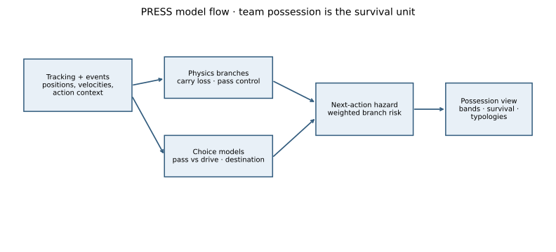

# PRESS

[](https://riccardobergamin.github.io/PRESS/)


**Possession Risk Estimate from Spatio-temporal State** (PRESS) is an independent, work-in-progress, physics-informed framework for estimating possession-loss risk in football from tracking data.

**[Website & documentation](https://riccardobergamin.github.io/PRESS/)** · [Getting started](https://riccardobergamin.github.io/PRESS/usage.html) · [Benchmarks](https://riccardobergamin.github.io/PRESS/benchmark.html)

## Motivation and scope

PRESS investigates how the game state and available on-ball actions shape possession-loss risk, a question that recent work approaches through action modelling, pressure and turnovers (Dick and Brefeld, 2023; Gu et al., 2024; Peters et al., 2024; Poli et al., 2024; Narizuka et al., 2026). Building on pitch control and Expected Possession Value (EPV) research, it combines physics-based action models with learned decision-making models (Spearman et al., 2017; Fernández et al., 2019, 2021; Bekkers, 2025). Applications include identifying recurring pressure patterns and assessing player performance in relation to the difficulty encountered, with definitions inspired by SkillCorner's pressure metrics (SkillCorner, 2026). The estimates can also support wider tactical analyses.

PRESS is an exploratory research and software development project investigating alternative formulations of EPV components. Its reusable Python package, methodological vignettes and benchmarks use a public ten-match sample, which limits the generalizability of fitted models and empirical findings. The relatively simple modelling choices reflect this sample and the project's exploratory scope; see [Modelling choices](https://riccardobergamin.github.io/PRESS/pipeline.html#modelling-choices).

PRESS estimates two complementary outcomes:

- **Hazard (h):** the probability of losing *team possession* during the next on-ball action.
- **xLoss:** the probability that the *current carrier's individual possession* eventually ends in a loss (SkillCorner, 2025, p. 52), including the risk following a successful carry.

The model considers two canonical actions: a **ball drive**, retaining control for a conventional one-second interval, and a **pass**, attempting to transfer the ball to a teammate over a variable duration. Their starting points define a discrete sequence of game states across successive ball carriers, at which vulnerability is evaluated. The corresponding loss probabilities can be interpreted as a discrete-time hazard (Singer and Willett, 2003), which can also be evaluated at intermediate tracking frames. See the [segmentation guide](vignettes/setup/possession_and_checkpoint_setup.ipynb) for the definition of canonical actions and checkpoints.

Following SkillCorner's approach of classifying defensive pressure into bands (SkillCorner, 2026), PRESS defines possession-difficulty bands from the hazard, using the survival-analysis concept of possession half-life. See the [hazard and bands vignette](vignettes/06_composed_risk/06_composed_risk.ipynb) for details.

## Model overview



PRESS combines five components:

- **Ball-drive risk:** estimates the probability of losing control during a one-second carry.
- **Pass probability:** estimates pass-completion probability for a given destination.
- **Pass selection:** models the choice of pass destination.
- **Action selection:** models the choice between passing and carrying.
- **Residual risk:** estimates eventual individual-possession loss following a successful carry.

Ball-drive risk and pass probability are physics-based models; action selection, pass selection and residual risk use statistical models incorporating physical, tactical and contextual features.

The [case studies](vignettes/07_case_studies/07_case_studies.ipynb) illustrate pressure patterns, player profiles and performance; model fitting and evaluation are documented in the [benchmarks](benchmark.qmd).

## Quick start

PRESS represents one match. `PRESS.from_skillcorner(...)` loads SkillCorner files and prepares velocities, possessions and actions; prepared data from other providers can be passed directly to `PRESS(tracking_data, ...)`. Initialization validates and copies inputs without running inference.

The workflow is **load → navigate → compute → retrieve → plot or save**. For example:

```python
import os
from pathlib import Path
from PRESS import PRESS
from PRESS.visualization import plot_ball_drive_risk

match_dir = Path(os.environ["SKILLCORNER_OPENDATA"]) / "data/matches/2006229"
press = PRESS.from_skillcorner(match_dir)
actions = press.get_actions(valid_only=True)
frame_id = int(actions.frame_start.iloc[0])
press.compute_ball_drive_risk(frame_id)
result = press.get_ball_drive_risk_result(frame_id)
fig, ax = plot_ball_drive_risk(press, frame_id, show=False)
fig.savefig("drive_risk.png", dpi=160)
press.save_results("outputs/match_results")
```

`compute_risk_frame(frame_id)` estimates h; setting `include_residual=True` also computes conditional residual risk and xLoss. Plot functions return figure and axes. Results are saved as JSON metadata and compressed NPZ arrays, with fingerprints for inputs and models. See [Using the package](usage.qmd) and the [match workflow](vignettes/00_match_workflow/00_match_workflow.ipynb).

## Installation and reproducibility

Python 3.11 (the verification interpreter) or 3.12 is supported for the documented reproduction workflow. To install the package with data-loading and vignette dependencies and run the checks:

```bash
python3.11 -m venv .venv
. .venv/bin/activate
pip install -e '.[io,vignettes]'
python scripts/check_environment.py --extras io,vignettes
python -m examples.checkpoint --help
python scripts/rebuild_vignettes.py
python scripts/check_docs.py
```

Re-executing SkillCorner examples requires the original match JSON, tracking JSONL and dynamic-event CSV under `SKILLCORNER_OPENDATA`; precomputed Parquet files are not required. Saved figures and notebook outputs can be rendered without the original input data. The command-line example requires `--match-dir`. See the [data and preprocessing guide](data.qmd) and [data setup notes](data/README.md).

## Documentation

The **[PRESS website](https://riccardobergamin.github.io/PRESS/)** contains the complete user guide, methodological vignettes, benchmark evaluations and API reference.

- **Getting started:** [datasets and preprocessing](data.qmd), [using the package](usage.qmd), [possession segmentation](vignettes/setup/possession_and_checkpoint_setup.ipynb), [real-match workflow](vignettes/00_match_workflow/00_match_workflow.ipynb) and [other data providers](external-data.qmd).
- **Models:** [ball-drive risk](vignettes/01_ball_drive_risk/01_ball_drive_risk.ipynb), [pass probability](vignettes/02_pass_probability/02_pass_probability.ipynb), [pass selection](vignettes/03_pass_selection/03_pass_selection.ipynb), [action selection](vignettes/04_action_selection/04_action_selection.ipynb) and [residual risk](vignettes/05_residual_risk/05_residual_risk.ipynb).
- **Risk and applications:** [composed hazard and bands](vignettes/06_composed_risk/06_composed_risk.ipynb), [case studies and reports](vignettes/07_case_studies/07_case_studies.ipynb), [Ball Carrier Open Space](vignettes/spatial_features/bcos/10_bcos.ipynb) and [Expected Threat](vignettes/spatial_features/expected_threat/11_expected_threat.ipynb) (Singh, 2018).
- **Evaluation and reference:** [benchmark overview](benchmark.qmd), [API](api.qmd), [solvers](solvers.qmd), [getters](reference/getters.qmd), [plots](reference/plots.qmd), [research pipeline](pipeline.qmd) and [roadmap](roadmap.qmd).

## Data and repository organization

PRESS uses ten Australian A-League 2024/25 matches from [SkillCorner open data](https://github.com/SkillCorner/opendata), subject to SkillCorner's attribution request. Raw tracking and event files and match-level derived tables are not distributed here. The MIT license applies to the software only. The repository includes fitted model artifacts, aggregate benchmark results and saved real-match illustrations.

- `PRESS/`: importable package (`core`, `io`, `model`, `physics`, `utils`, `spatial_features`, `visualization`).
- `vignettes/`, `benchmarks/`: notebooks and task-level evaluations.
- `pipeline/`: preprocessing, feature generation, training, evaluation and deployment refits.
- `scripts/`, `examples/`: checks, notebook rebuilding and command-line examples.
- `docs/`, `figures/`, `data/`: provenance, figures and data setup notes.
- `*.qmd`, `reference/`, `_quarto.yml`: website content and navigation; `.github/workflows/publish-site.yml` publishes the site.
- `references/refs.bib`, `REFERENCES.md`: bibliographic records.

## AI assistance

The author designed the modeling framework and validation protocols, and developed the core software architecture. Codex (OpenAI) assisted with pipeline implementation, code refinement, and debugging under the author's supervision.

## Citation

Cite a release using [CITATION.cff](CITATION.cff), including the repository version or commit used.

## References

- Bekkers, J. (2025). Pressing intensity: an intuitive measure for pressing in soccer. [arXiv:2501.04712](https://arxiv.org/abs/2501.04712).
- Dick, U. and Brefeld, U. (2023). Action rate models for predicting actions in soccer. AStA Advances in Statistical Analysis 107, 29–49. [doi:10.1007/s10182-022-00435-x](https://doi.org/10.1007/s10182-022-00435-x).
- Fernández, J., Bornn, L. and Cervone, D. (2019). Decomposing the immeasurable sport: a deep learning expected possession value framework for soccer. MIT Sloan Sports Analytics Conference.
- Fernández, J., Bornn, L. and Cervone, D. (2021). A framework for the fine-grained evaluation of the instantaneous expected value of soccer possessions. Machine Learning 110, 1389–1427. [doi:10.1007/s10994-021-05989-6](https://doi.org/10.1007/s10994-021-05989-6).
- Gu, C., Na, J., Pei, Y. and De Silva, V. (2024). Player Pressure Map — A Novel Representation of Pressure in Soccer for Evaluating Player Performance in Different Game Contexts. [arXiv:2401.16235](https://arxiv.org/abs/2401.16235).
- Narizuka, T., Sakamoto, I., Yamamoto, K. and Yamazaki, Y. (2026). Quantifying defensive pressure on the ball carrier in soccer based on minimum arrival time. [arXiv:2606.09452](https://arxiv.org/abs/2606.09452).
- Peters, A., Parmar, N., Davies, M., Reeves, M., Sormaz, M. and James, N. (2024). Expected Pass Turnovers (xPT) — a model to analyse turnovers from passing events in football. Journal of Sports Sciences. [doi:10.1080/02640414.2024.2379697](https://doi.org/10.1080/02640414.2024.2379697).
- Poli, R., Ravenel, L. and Besson, R. (2024). Playing under high pressure and ball retention. CIES Football Observatory, Monthly Report 93. [Report](https://football-observatory.com/IMG/sites/mr/mr93/en/).
- Singer, J. D. and Willett, J. B. (2003). Applied Longitudinal Data Analysis: Modeling Change and Event Occurrence. Oxford University Press.
- Singh, K. (2018). [Introducing Expected Threat (xT)](https://karun.in/blog/expected-threat.html).
- SkillCorner (2025). [Dynamic Events: CSV Specifications](https://26560301.fs1.hubspotusercontent-eu1.net/hubfs/26560301/Guides/Dynamic%20Events/20250216%20-%20Dynamic%20Events%20CSV%20Specifications.pdf). Version dated 16 February 2025, p. 52: xLoss definition.
- SkillCorner (2026). [Introducing SkillCorner's new pressure metrics](https://skillcorner.com/us/articles/introducing-skillcorners-new-pressure-metrics).
- Spearman, W., Basye, A., Dick, G., Hotovy, R. and Pop, P. (2017). [Physics-based modeling of pass probabilities in soccer](https://static.hudl.com/craft/downloads/SSAC17-Physics-Based-Modeling-of-Pass-Probabilities-in-Soccer.pdf). MIT Sloan Sports Analytics Conference.