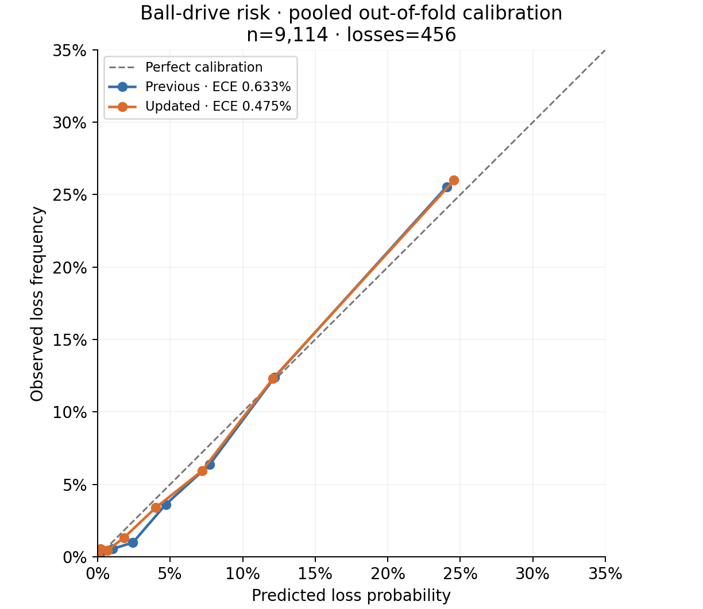
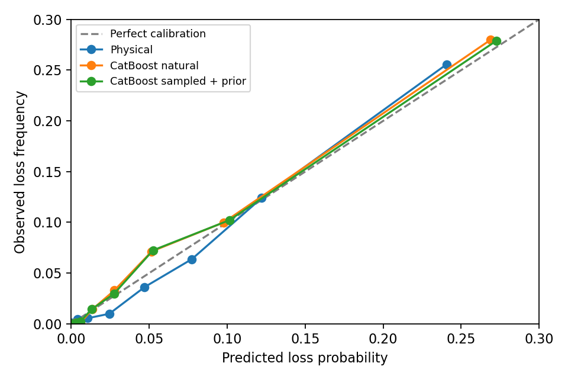

[Model and example](../vignettes/01_ball_drive_risk/01_ball_drive_risk.ipynb) · [All benchmarks](../benchmark.qmd)

The final carry component estimates **loss within one second, conditional on carrying**. It uses a physics-informed competing-risk likelihood with a shared survival probability, logistic arrival gates, and an additive tackle rate. It is separate from end-of-possession xLoss. **own derivation**

## Cohort and evaluation {#ball-drive-benchmark}

The cohort contains **9,114 carry attempts, 456 losses (5.003%), across ten SkillCorner matches**. Goalkeeper carriers, shot-ending individual possessions and successful tails shorter than one second are excluded. Goalkeepers remain among defenders. Individual-possession start and end must be matched. Loss-ending possessions additionally require an associated matched on-ball engagement (OBE). This removes 20 unverified loss parents: 34 sections, including 20 terminal losses and 14 preceding successful sections. OBE is not required for successful-ending possessions and is never a predictor. SkillCorner possession loss concerns individual control, including some out-of-play cases where the team retains the restart; it does not always mean a team turnover. Only the final failed section is a loss; early and zero-duration failures retain the one-second Bernoulli target. Failed passes are outside this task. This training cohort differs from the additional snapshots available for arbitrary-frame evaluation. **design choice**

A successful canonical second contributes $S(1)$ to the outcome likelihood; a loss contributes $1-S(1)$ even when it occurs earlier. No exact-failure-time likelihood replaces this one-second target. Successful short tails are outside this final fit. The [model vignette](../vignettes/01_ball_drive_risk/01_ball_drive_risk.ipynb#likelihood-priors-and-posterior-estimates) derives the Bernoulli likelihood, actual priors and joint posterior approximation.

Five outer folds hold out two complete matches each. Spline transformations and smoothing selection use training matches and inner validation matches; metrics concatenate the five held-out prediction sets, with each observation appearing once. Metrics, including quantile bins, are recomputed on that union; neither fold ECE nor fitted parameters are averaged. The null model uses each outer training set's loss frequency. Gain is `1 − CE_model / CE_null`; ECE uses ten equal-count quantile bins weighted by their observation counts. Physical-model CE uses natural logarithms and a probability floor of 1e-6. The CatBoost protocol uses standard float64 log-loss clipping; the downloadable common-floor sensitivity separates numerical tail effects. No resampling or post-hoc calibration is used in the final model. These ten matches also informed model-family development: this is a development benchmark, without an untouched external evaluation. **design choice**

## Log-linear proportional-hazard-inspired model and splines

The starting model uses $\lambda(t)=\lambda_0\exp(\beta_v v_B+\beta_B B(t))$. The additive version replaces the linear covariate shapes with penalized splines; it preserves positive multiplicative rates, defender reachability and shared survival. Both are likelihood-based. This comparison examines functional form, not a standalone Cox proportional-hazards test. See the [ball-drive vignette](../vignettes/01_ball_drive_risk/01_ball_drive_risk.ipynb) for equations, references and tracking-based kinematic justification.

The following **historical ablation uses the original 9,148 sections / 476 losses**. Its within-cohort comparisons remain useful; its values should not be subtracted from the final filtered-cohort results as an isolated model improvement.

| Model | Cross-entropy | Gain over null | Quantile ECE |
|---|---:|---:|---:|
| **Log-linear baseline**; historical TTI; Euler | **0.158336** | **22.609%** | **0.902%** |
| Additive speed/boundary reference; historical TTI; Euler | 0.156796 | 23.361% | 0.614% |
| Preserve defender initial speed above the cap | 0.156568 | 23.473% | 0.621% |
| Add individual interception-angle spline | 0.155175 | 24.154% | 0.697% |
| Use signed boundary distance | 0.153320 | 25.060% | 0.644% |
| **Historical exponential Euler, refitted** | **0.153312** | **25.064%** | **0.642%** |

The historical exponential-Euler Brier score is **0.041968**, ROC AUC **0.87246**. Mean predicted loss is **5.268%**, versus **5.203%** observed. The angle improves cross-entropy without improving pooled ECE in this comparison. The integration change has negligible predictive effect; exponential Euler is retained for probability-mass preservation. Rows describe successive changes on the same cohort, not isolated causal effects.

Signed boundary distance matters mainly for unusual outside-pitch states: 210 trajectories project outside during the horizon, including 45 already outside at the initial frame. About 80.5% of its cross-entropy improvement comes from those 45 rows. This correction should not be presented as a general improvement on ordinary interior carries. Annotation and synchronization noise remain possible; no labels were changed to obtain these results.

The downloadable [metric table](../data/benchmarks/ball_drive/metrics.csv), [calibration bins](../data/benchmarks/ball_drive/calibration_deciles.csv) and [source hashes](../data/benchmarks/ball_drive/provenance.json) contain aggregate results from the outfield log-linear baseline and audited runs 14–15. The baseline and spline rows use the same 9,148 states, labels and outer match pairs; the final changes are presented separately.

## Final physical model on the verified-loss cohort

The OBE-filtered run refits the same physical specification, preserving natural proportions and the fixed one-second Bernoulli target. Four six-fit/two-validation rotations inside each outer eight-match training set select smoothing; all five select `main_1_angle_100`. Pooled held-out CE is **0.143483**, null CE **0.198722**, gain **27.798%**, and ten-quantile ECE **0.475%**. Brier is **0.040068**, ROC AUC **0.88547**, and loss-class PR AUC **0.30837**. Predicted loss averages **5.059%**, versus **5.003%** observed.

On these same retained rows, the historical weights give CE **0.143921** and ECE **0.633%**. The refit improves CE only modestly; much of the difference from the historical all-row score reflects cohort selection, not a better functional form. No difficult retained example is removed based on model error. [Final physical metrics](../data/benchmarks/ball_drive/filtered_physics_metrics.csv), [fold parameters](../data/benchmarks/ball_drive/filtered_physics_parameters.csv), [calibration bins](../data/benchmarks/ball_drive/filtered_calibration_deciles.csv), [audit provenance](../docs/ball-drive-benchmark-provenance.json).

{#fig-ball-drive-physical-calibration}

The updated curve follows the diagonal closely, with quantile ECE **0.475%**, compared with **0.633%** for the previous model on these same retained rows. In the highest-risk decile, mean predicted loss is **24.6%**, versus **26.0%** observed; smaller deviations remain in the intermediate-risk bins. These are full five-fold pooled results, not the two-match validation diagnostic used during pass-selection development. [Aggregate bins](../data/benchmarks/calibration/pooled_bins.csv), [pooled metrics](../data/benchmarks/calibration/pooled_metrics.csv), [plot provenance](../docs/physical-calibration-provenance.json), [vector figure](../figures/ball_drive_physical_pooled_calibration.svg).

## Published ball-drive benchmarks

These are numerical references on different datasets, not a common leaderboard. Gains normalize CE against the corresponding null, which helps interpretation but does not remove differences in labels, prevalence, features and splits.

| Study / model | Training loss share | CE | Null CE | Gain over null | Quantile ECE |
|---|---:|---:|---:|---:|---:|
| Fernández et al.; neural network | 9.4% overall | 0.2803 | ≈0.311696* | ≈10.07%* | 0.51% |
| Stalpaert; CatBoost start-only, natural | 6.1% table heading | 0.2059 | 0.2455 | 16.13% | — |
| Stalpaert; CatBoost start-only, resampled | **10% training only** | **0.1053** | 0.2455 | **57.11%** | **1.64%** |
| PRESS; historical log-linear rate | 5.20% pooled | 0.158336 | 0.204591 | 22.61% | 0.90% |
| PRESS; final physical spline rate | 5.00% pooled | 0.143483 | 0.198722 | 27.80% | 0.475% |
| PRESS; CatBoost, natural | 5.00% pooled | 0.139855 | 0.198722 | 29.62% | 0.490% |
| PRESS; CatBoost, 10% + prior correction | 10% training only | 0.139928 | 0.198722 | 29.59% | 0.397% |

Fernández: Tables 3–4 and §§5.2/6.3–6.6; split by match, 633 matches, one-second sections [@fernandez2021]. *The approximate null is entropy at the published **overall** success rate of 90.6%, not a recovered test-fold null. No pass-risk numbers are mixed into this table.

Stalpaert: Tables 4.4/4.7, §§4.4/4.7; test ratios remain natural. The 1.64% ECE belongs to the selected resampled start-only component, not every row. The prose says 6.3% failed sections, while the natural-training heading says 93.9% success; preserve this discrepancy. He labels the **last two seconds** of failed drives negative; PRESS labels only the terminal section [@stalpaert2022]. Brier scores are 0.0571 (natural) and 0.0251 (10% loss). Values and locators are downloadable in the [comparison table](../data/benchmarks/ball_drive/literature_comparison.csv).

### Final exploratory CatBoost and training-only resampling

This separate experiment uses the **same 9,114 sections and 456 losses** as the final physical model. It does not replace the likelihood in the package. Its 50 inputs are derived from the initial tracking snapshot and projected constant-velocity carrier path:

| Feature block | Count | Definition |
|---|---:|---|
| Carrier speed | 1 | Initial speed magnitude from the current centred seven-frame tracking estimate |
| Boundary distance | 3 | Signed minimum distance to any of the four lines at 0, 0.5 and 1 s |
| Defender TTI | 9 | Three smallest TTI, independently ranked at 0, 0.5 and 1 s |
| Encounter curve | 11 | All-defender encounter probability at 0, 0.1, …, 1 s |
| Carrier and goal geometry | 8 | Initial/projected x/y, distance and bearing to opponent goal centre |
| Three nearest defenders | 15 | Initial distance, defender speed, relative closing speed, transverse relative speed and front/back position cosine for each fixed defender identity |
| Local geometry | 3 | Defender counts within 2/5 m and position-angle cosine between the nearest two |

For $r=x_D-x_B$, $n=r/\|r\|$ and $w=v_D-v_B$, closing speed is $-n\cdot w$ and transverse speed is $\sqrt{\|w\|^2-(n\cdot w)^2}$. Front/back cosine compares the defender's **relative position** with carrier velocity; it is not the angle between their velocity vectors. It is undefined below carrier speed 1 m/s. CatBoost handles missing values. Future observed position, outcome, engagement, duration, receiver identity and player/team identities are not features.

TTI uses **vmax = 7 m/s**, linear and turning acceleration **7 m/s²**, preserved initial overspeed, fixed-position Pleuler realignment and no reaction delay. Encounter features use $F_i(t)=\operatorname{sigmoid}[\pi(t-\tau_i(t))/(\sqrt3s)]$ and $E(t)=1-\prod_i(1-F_i(t))$, following the reachability interpretation [@bekkers2025; @spearman2018beyond]. Crucially, **s comes from the corresponding physical training fit**, not the former fixed 0.45 s: six-match values inside validation rotations and eight-match values for outer refits, identical in both sampling arms. Inner s spans **0.28076–0.31419 s**; outer s **0.28866–0.30600 s**. The full ten-match export is never used to create held-out benchmark features.

Five outer folds hold out two entire matches. Four inner **6 fit + 2 validation** rotations within the other eight select the full **36-configuration** grid: depth 4/6/8 × learning rate 0.02/0.05/0.1 × L2 1/3/10/30. Each candidate builds 3,000 trees; pooled validation CE selects a common prefix among 25, 50, …, 3,000. There is no early elimination of slower configurations. Native CatBoost binary Logloss, `SymmetricTree`, `Plain` boosting, Bayesian bootstrap (temperature 1), random strength 1 and border count 254 are used, without custom derivatives or class weights. Symmetric trees are the standard native policy; the grid explores capacity, step size and regularization without changing the architecture. The selection principle follows the [CatBoost parameter documentation](https://catboost.ai/docs/en/concepts/parameter-tuning); the particular grid and match grouping are project choices.

For each selected configuration, seeds 19/41/73 produce an average-probability ensemble: four inner fits and one outer eight-match refit per seed. This gives **159 fits per task, 1,590 in total**. Each task is one sampling arm and outer fold. Selected prefixes range from 200 to 1,125 trees; none reaches the cap. Parameters are selected separately within each outer fold, not from its test score. [Selected configurations](../data/benchmarks/ball_drive/catboost_final_parameters.csv).

The sampled arm retains every loss and samples nine successes per loss uniformly without replacement, **inside fitting subsets only**. Validation, calibration and test retain natural prevalence. Candidate selection for this arm evaluates prior-corrected probabilities. If successes are retained with probability $q=9N_{loss}/N_{success}$, the known sampling correction is

$$\operatorname{logit}(p_{population})=\operatorname{logit}(p_{sample})+\log q.$$

This is a class-prior correction, not a Bayesian parameter prior. Separately, Platt and isotonic are fitted to natural-label **inner OOF raw ensemble scores** on the eight training matches, then applied to the two test matches. Platt uses fixed weak regularization C=1000; isotonic is standard monotone regression with clipped extrapolation. No prior correction is applied before these learned calibrators, and no calibrator is tuned on test data.

| Training / output | Pooled CE | Gain over null | Quantile ECE |
|---|---:|---:|---:|
| **Natural, raw** | **0.139855** | **29.623%** | **0.490%** |
| Natural, Platt | 0.139934 | 29.583% | 0.483% |
| Natural, isotonic | 0.147136 | 25.959% | 0.468% |
| 10% loss, raw | 0.150333 | 24.350% | 3.311% |
| **10% loss, analytic prior correction** | **0.139928** | **29.586%** | **0.397%** |
| 10% loss, Platt | 0.140049 | 29.525% | 0.401% |
| 10% loss, isotonic | 0.143942 | 27.566% | 0.413% |

Natural raw has the lowest observed CE. Platt substantially repairs raw resampling calibration, but analytic prior correction is marginally better. **Resampling produces no meaningful CE benefit here**, while pooled ECE improves slightly. CatBoost natural reduces CE by **2.53% relative** to the physical model (+1.83 percentage points of gain over the same null), improving eight of ten matches. Its loss PR AUC is **0.30794**, essentially unchanged from the physical **0.30837**. Reporting the best observed output is exploratory; it is not a test-selected deployment rule. [All final metrics](../data/benchmarks/ball_drive/catboost_final_metrics.csv).

Isotonic assigns zero loss probability to one actual loss in each arm; natural isotonic also assigns one to a success. Standard float64 log-loss strongly penalizes these rare extreme errors, although ECE remains small. With a **common 1e-6 floor applied to every model**, isotonic CE is 0.142259 (natural) and 0.141504 (sampled), still worse than CatBoost raw/Platt. This sensitivity does not change the prespecified primary scores. [Common-floor diagnostic](../data/benchmarks/ball_drive/catboost_common_floor.csv).

The representations overlap substantially with Stalpaert's spatial, pitch-control and path-density information, without replicating his exact feature transformations. Limited data scale is a plausible explanation for the absent resampling benefit, but labels, features, splitting and architecture also differ; these results cannot isolate the cause or prove that useful 2D information is exhausted. Earlier 33-feature and richer-feature results remain in the [historical exploration table](../data/benchmarks/ball_drive/catboost_exploration.csv). [Final audit provenance](../docs/ball-drive-benchmark-provenance.json).

### Further extension motivated by the published resampling result

The large within-study CatBoost gain motivates a further hybrid: use a cross-fitted physics prediction plus 2D/context features, then compare natural training with 10% loss training at fixed match folds. The tests above did not include the fitted likelihood score as an input. Tree splits can express nonlinear interactions and subgroups absent from the present additive rate. Resampling changes their training emphasis; it does not create information. Evaluate on natural held-out data and fit any calibration inside training/validation only. This hybrid is an extension to test, not an already established gain for PRESS. **design choice**

The present likelihood's sampling experiments showed no convincing held-out gain after accounting for the changed class prior; raw resampling distorted calibration. Published CatBoost + sampling results therefore motivate this combination rather than replacing the TTI with a more agile routine. The sources do not isolate architecture, features and sampling across datasets. **design choice**

## Closed model specification

The carrier is a point moving as $x_B(t)=x_B(0)+v_B(0)t$. The defender routine retains the historical fixed-position turning delay $v\theta/a_{turn}$, followed by straight-line acceleration toward the target. Maximum linear and turning accelerations are separate user parameters; the benchmark sets both to **7 m/s²**, with **vmax = 7 m/s**. Initial speed above vmax is retained without additional acceleration. The engagement-disc experiment is not included. The runtime does not take an observed acceleration input or use future observed acceleration.

The constants are motivated by movement categories and arrival-model literature, then checked empirically using **post-hoc engineered rules**: **speed > 2 m/s with Q95**, and multiple acceleration checks using **a > 3 or >4 m/s² with Q95, Q98 and Q99**, with explicit populations and sampling units. About **5.5 m/s** marks entry into high-speed running and **7 m/s** entry into sprinting in Bradley's categories [@bradley2009running]; Spearman supplies the reference acceleration of **7 m/s²** [@spearman2018beyond]. Defender engagement speed Q95 is **7.050 m/s**; the historical engagement-peak acceleration Q99 is **6.966 m/s²**. These are consistency checks on rounded effective scales, not an independent prospective parameter estimate. The [kinematic conventions](../docs/kinematic-parameter-conventions.md) distinguish frame quantiles from event peaks, document the post-hoc rationale, and discuss running with the ball and the BCOS carrier cap. This audit convention changes neither the benchmark cohort nor the fitted model.

At every integration step, the signed boundary margin is the minimum inward distance to the four lines of a centred **105 × 68 m** pitch. It becomes negative outside; the carrier is neither stopped nor assigned an automatic loss. The log tackle rate combines a baseline, additive speed and boundary effects, and a small individual angle spline. The angle is between carrier velocity and the defender's predicted final approach to the projected carrier position. It is a motion-based heading proxy, not observed posture. Its contribution is masked for carrier speed below 1 m/s or undefined direction. **own derivation**

Speed and boundary use five-knot restricted cubic bases; angle uses four knots. There are no interactions between these effects. The selected smoothing setting was `main_1_angle_100` in all five outer fits. Exponential Euler uses dt = 0.04 s and shares remaining survival mass across defenders. It is first-order for time-varying rates; mass preservation does not establish timestep convergence. The final refit estimates all coefficients and basis transformations anew on the ten matches; fold coefficients are not averaged.

### Numerical integration

The implementation uses exponential Euler integration. Over a step of width $\Delta$, hold the hazards fixed and write $H=\sum_i h_i$. The step loss mass is $S(1-e^{-H\Delta})$ and, for $H>0$, defender $i$ receives the fraction $h_i/H$. Survival is updated as

$$
S\longleftarrow Se^{-H\Delta}.
$$

This allocation preserves probability mass across the competing causes.

## Real-match application

The [model vignette](../vignettes/01_ball_drive_risk/01_ball_drive_risk.ipynb#real-match-example-velupillay-loses-the-ball-to-payne) provides the real SkillCorner example and executable package code, with initial risk-colored defenders and the observed opponent recovery. That selected case illustrates model use; it is not another benchmark observation or an accuracy estimate.

## Final refit and checks

Run 47 fits the accepted specification once on all ten matches and the final 9,114-row OBE-verified cohort. It is **not another test fold** and produces no replacement for the OOF metrics above. Its arrival dispersion is **s = 0.299632** and baseline tackle rate **lambda0 = 0.344563 s⁻¹**; lambda0 is an intercept parameter, not an average tackle probability.

The fit records successful convergence, maximum gradient 0.00378 and a valid Laplace approximation. A separate public-runtime export check verifies prediction parity and probability mass. Loading the exported JSON through the frozen package reproduces all 9,114 training predictions within **3.06 × 10⁻⁸** absolute probability; maximum survival-plus-cause mass error is **2.22 × 10⁻¹⁶**. Short horizons 0, 0.17, 0.4 and 1 s are monotone in the verification sample. [Refit provenance](../docs/ball-drive-refit-provenance.json).

## Limits and extensions

The model represents average player skills and individual reachability, with limited encounter geometry. Successful and failed carries overlap substantially in available 2D features; this does not prove that all useful 2D information has been exhausted. Body orientation, ball control, contact mechanics, individual ability, annotation error and intrinsic outcome variation can contribute. Collective defensive behaviour and richer tactical context remain extensions. Tracking velocities use a centred seven-frame window: this offline benchmark is not a strictly causal live system.

A more flexible tree model with contextual features, the physics likelihood as an input and training-only resampling is a separate future architecture. The resampling experiments on the present likelihood did not show a convincing held-out benefit. Published numbers above are contextual benchmarks with their definitions and sampling differences recorded, not a same-dataset ranking.
