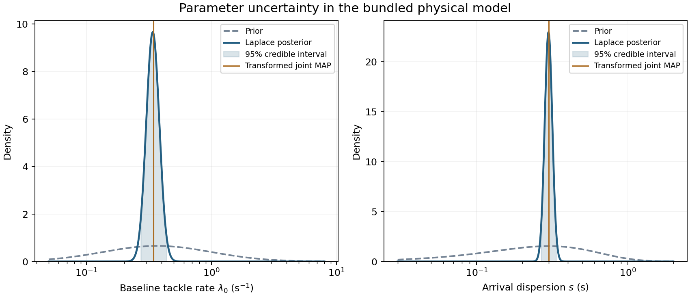

[Model and example](../vignettes/01_ball_drive_risk/01_ball_drive_risk.ipynb) · [All benchmarks](../benchmark.qmd)

This benchmark documents the selection, estimation, and predictive evaluation of the PRESS ball-drive risk model. The target is the loss of individual possession within a canonical one-second carry, conditional on carrying. The [model vignette](../vignettes/01_ball_drive_risk/01_ball_drive_risk.ipynb) defines the player-motion approximation, probabilistic defender reachability, tackle intensity, and competing-risk equations. Here we focus on the evidence supporting the fitted specification.

## 1. Cohort and task-specific evaluation {#ball-drive-benchmark}

The final cohort comprises **9,114 carry attempts**, including **456 losses (5.003%)**, from ten SkillCorner matches. The one-second segmentation of individual possessions is described in [Possessions and checkpoints](../vignettes/setup/possession_and_checkpoint_setup.ipynb). For this specific task, loss-ending possessions without an associated on-ball engagement (OBE) are excluded, since such losses are not guaranteed to result from defensive pressure. The OBE is used only to verify outcomes, never as a predictor, and successful-ending possessions do not require one.

Only the final failed section of a possession is labelled as a loss. A loss observed before one second still contributes the one-second failure probability, $1-S(1)$; a successful canonical second contributes $S(1)$. The model does not fit the exact time of the intervention or the identity of the defender. Individual possession loss can include out-of-play events without a team turnover; failed passes are excluded from this task.

The shared evaluation procedure described in [Benchmarks](../benchmark.qmd) defines the five outer match folds, the nested 6+2 validation rotations, pooled held-out evaluation, and performance metrics. For Ball-drive risk, the four inner rotations select the spline smoothing specification using the six fitting and two validation matches. The task-specific null model predicts the loss prevalence estimated from the eight development matches of each outer fold. The final physical model is fitted without resampling or post-hoc calibration.

## 2. Final model specification and selection

The evaluated model is the reachability-gated competing-risk specification with an additive spline tackle intensity,

$$
\log\lambda_i(t)=\alpha+g_v(\lVert v_B\rVert)+g_B(B(t))+g_\phi(\phi_i(t)),\qquad \alpha=\log\lambda_0.
$$

The terms describe carrier speed, signed distance to the pitch boundary, and defender approach angle, respectively. Restricted cubic spline bases allow nonlinear effects while retaining the common possession-survival process. The [model vignette](../vignettes/01_ball_drive_risk/01_ball_drive_risk.ipynb) documents the kinematic conventions, the form of the spline functions, reachability functions, complexity allocation, priors, and competing-risk equations. The construction of the bases is in the [appendix on the spline basis](../appendix/ball-drive-spline-basis.qmd).

### Optimization

Every MAP fit in this study follows the same procedure: the fits of the nested validation, the refits on the eight development matches, and the final fit on all ten matches. The negative log-posterior is minimized with L-BFGS-B, using gradients from automatic differentiation. Before optimizing, the objective is evaluated, without moving them, at 33 initial points: one preset point and 32 random points drawn from the prior. The optimization starts from the point with the lowest objective, and if that point differs from the preset one, the optimization is also run from the preset point. Among the converged solutions, the one with the lowest final objective is retained. The preset point has $\lambda_0=0.4$ s$^{-1}$, $s=0.4$ s, $\beta_v=0.1$ and $\beta_B=-0.02$, with all nonlinear coefficients and the linear coefficient of the angle set to zero. These values come from estimates of the initial log-linear model. Initialization uses only the fitting data of each fit.

### Regularization grid and selection

Write $\rho_{\mathrm{bc}}$ for the shared nonlinear smoothing multiplier of the ball-carrier block (speed and boundary), and $\rho_\phi$ for the multiplier of the engagement block (approach angle). These are distinct from the tackle intensity $\lambda_i(t)$. The smoothing strengths were explored in an exploratory run over three values of different scale for each block, designed to contain the computational cost of nested cross-validation and not as a fine optimization of the smoothing. Tuning speed and boundary separately would require nine combinations instead of three for each angle specification, so the carrier block shares one multiplier, which does not force the two effects to be equal. The knot counts, the additive structure and the linear-coefficient priors are fixed, and validation selects the smoothing strengths and whether the angle is included.

| Component | Candidate specifications |
|---|---|
| Speed and boundary together | Linear terms only; or splines with $\rho_{\mathrm{bc}}\in\{0.01,1,100\}$ |
| Approach angle | Absent; or linear-plus-spline effect with $\rho_\phi\in\{0.01,1,100\}$ |

The three smoothing strengths, **0.01, 1 and 100**, span four orders of magnitude and cover weak, intermediate and strong curvature regularization. The Cartesian product contains **16 configurations** (four choices for speed and boundary times four for the angle). When angle is present, its linear coefficient keeps its prior, and $\rho_\phi$ penalizes only its two nonlinear coefficients. [Exact candidate grid and priority order](../data/benchmarks/ball_drive/spline_regularization_grid.json).

The selection is carried out separately in each of the five outer folds, using only the eight development matches of that fold. The test matches are never used.

1. **Inner splits.** The eight development matches are divided into four rotating **6 + 2** splits: in each split, six matches fit the model and two matches validate it, and every development match is a validation match exactly once.
2. **Fitting.** Each of the 16 configurations is fitted on the six fitting matches of each split. Knot locations and basis transformations are estimated on those matches and reused unchanged on the validation matches, and each MAP fit follows the optimization procedure above and runs to numerical optimizer convergence.
3. **Scoring.** Each configuration is scored by cross-entropy on the two validation matches of its split, which gives a cross-entropy for every development match.
4. **Reference candidate.** The candidate with the lowest observation-weighted cross-entropy across the eight validation matches is the reference.
5. **Paired comparison.** For each candidate $c$ and validation match $m$, let $\Delta_m=\mathrm{CE}_{c,m}-\mathrm{CE}_{\mathrm{best},m}$, and let $\bar\Delta_c$ be the observation-weighted mean difference. Its standard error is estimated by deleting one validation match at a time (match jackknife). A candidate is eligible when $\bar\Delta_c\leq\mathrm{SE}_{\mathrm{jackknife}}(\bar\Delta_c)$.
6. **Choice by priority.** Among the eligible candidates, the first in a prespecified priority order is selected: angle-absent configurations first, followed by angle multipliers 100, 1 and 0.01; within each group, linear main effects precede spline multipliers 100, 1 and 0.01. The order favours simpler and smoother configurations when their validation disadvantage is small relative to the uncertainty between matches. A more flexible configuration is therefore selected only when its reduction in cross-entropy exceeds the uncertainty between matches. The rule is not a test of statistical equivalence.
7. **Refit and test.** The selected configuration is refitted on all eight development matches and evaluated on the two held-out test matches.

The choice was identical across all five outer folds, and the selected configuration includes the approach angle: multipliers **1** for speed and boundary and **100** for approach angle. [Fold selection details](../data/benchmarks/ball_drive/spline_regularization_selection.csv). There is no resampling and no post-hoc probability scaling of the physical model.

| Spline effect | Fixed basis | Selected nonlinear penalty multiplier |
|---|---|---:|
| Carrier speed, $g_v$ | Restricted cubic spline, 5 knots | 1 |
| Signed boundary distance, $g_B$ | Restricted cubic spline, 5 knots | 1 |
| Defender approach angle, $g_\phi$ | Restricted cubic spline, 4 knots | 100 |

## 3. Predictive performance

Following the shared outer-fold protocol, the final spline specification was refitted on the eight development matches and evaluated on the two held-out matches. Pooled results for the verified-loss cohort are:

| Metric | Final spline model |
|---|---:|
| Observations / losses | 9,114 / 456 |
| Cross-entropy | **0.143483** |
| Null cross-entropy | 0.198722 |
| Gain over null | **27.798%** |
| Quantile ECE | **0.475%** |
| Brier score | 0.040068 |
| ROC AUC | 0.88547 |
| Loss-class PR AUC | 0.30837 |
| Mean predicted / observed loss | 5.059% / 5.003% |

[Final metrics](../data/benchmarks/ball_drive/filtered_physics_metrics.csv), [fold parameters](../data/benchmarks/ball_drive/filtered_physics_parameters.csv), and [audit provenance](../docs/ball-drive-benchmark-provenance.json).

## 4. Final parameter estimates and uncertainty

The selected specification was fitted to all ten matches and all **9,114** verified sections. Following the [shared deployment protocol](../benchmark.qmd#model-stability-and-final-refitting), this fit supplies the package parameters and does not contribute to held-out performance estimates.

The likelihood is Bernoulli on the one-second loss outcome, and the coefficients, baseline tackle rate, and logistic arrival-time dispersion are estimated jointly by maximum a posteriori (MAP) under the priors defined in the [model vignette](../vignettes/01_ball_drive_risk/01_ball_drive_risk.ipynb). A local Laplace approximation to the joint posterior supplies approximate marginal uncertainty. In log coordinates, the reported approximations are

In the final fit, the preset initial point had the lowest initial objective, so a single optimization was run.

$$
\log\lambda_0\mid D\ \dot\sim\ \mathcal N(-1.065479,\,0.014572626),
\qquad
\log s\mid D\ \dot\sim\ \mathcal N(-1.205201,\,0.003378886),
$$

where the second argument denotes **variance**. The resulting summaries are:

| Parameter | Joint MAP | Approximate posterior mean | 95% credible interval |
|---|---:|---:|---:|
| Arrival dispersion $s$ | **0.299632 s** | 0.300139 s | 0.267368–0.335789 s |
| Baseline tackle rate $\lambda_0$ | **0.344563 s$^{-1}$** | 0.347082 s$^{-1}$ | 0.271965–0.436539 s$^{-1}$ |

The approximate credible intervals use $\exp\{\hat m\pm1.96\sqrt{\Sigma_{kk}}\}$, and the approximate posterior means use $\exp(\hat m+\Sigma_{kk}/2)$. The baseline rate is an intercept-scale intensity, not an average tackle probability. Package predictions use the joint MAP parameters, not posterior averaging.

These intervals describe uncertainty conditional on the model, movement assumptions, prior strengths, and training data; they do not include model-selection uncertainty or systematic annotation error. The final fit converged, with a valid Laplace approximation. [Posterior summaries](../data/examples/ball_drive/posterior_summary.json) and [refit provenance](../docs/ball-drive-refit-provenance.json).

## 5. Comparison with published results

Published results provide context. The studies differ in sample size, loss definitions, input representations, train/test splits and prevalence, and the gain over each study's null is reported for orientation.

| Study / model | Training loss share | CE | Null CE | Gain over null | Quantile ECE |
|---|---:|---:|---:|---:|---:|
| Fernández et al.; neural network | 9.4% overall | 0.2803 | ≈0.311696* | ≈10.07%* | 0.51% |
| Stalpaert; CatBoost start-only, natural | 6.1% table heading | 0.2059 | 0.2455 | 16.13% | — |
| Stalpaert; CatBoost start-only, resampled | 10% training only | 0.1053 | 0.2455 | 57.11% | 1.64% |
| PRESS; final physical spline | 5.00% pooled | 0.143483 | 0.198722 | 27.80% | 0.475% |

*For Fernández et al., the approximate null uses entropy at the published overall success rate (90.6%), not a recovered test-fold null [@fernandez2021]. Stalpaert's published results use a different drive-labelling convention, marking the last two seconds of failed drives as unsuccessful, whereas PRESS labels only the terminal section [@stalpaert2022]. [Literature comparison details](../data/benchmarks/ball_drive/literature_comparison.csv).

### Resampling experiment motivated by Stalpaert

Stalpaert reports a substantial improvement with training-set resampling. To examine whether a similar effect arises in our data, we trained CatBoost on the same **9,114 sections and 456 losses** used to evaluate the final physical model. Its 50 snapshot-derived features cover carrier speed, boundary geometry, defender times to interception, encounter probabilities, and local spatial relationships, broadly overlapping the information used by Stalpaert, although not reproducing every feature transformation or convention. The feature representation comprises the following 50 inputs, all derived from the initial tracking snapshot and the carrier's projected constant-velocity path:

| Feature block | Count | Definition |
|---|---:|---|
| Carrier speed | 1 | Initial speed magnitude from the centred seven-frame tracking estimate |
| Boundary distance | 3 | Signed minimum distance to the four pitch lines at 0, 0.5 and 1 s |
| Defender time to interception (TTI) | 9 | Three smallest TTIs, independently ranked at 0, 0.5 and 1 s |
| Encounter probability curve | 11 | All-defender encounter probability at 0, 0.1, …, 1 s |
| Carrier and goal geometry | 8 | Initial/projected x/y, distance and bearing to the opponent goal centre |
| Three nearest defenders | 15 | Initial distance, defender speed, relative closing speed, transverse relative speed and front/back position cosine for each fixed defender identity |
| Local geometry | 3 | Defender counts within 2 and 5 m, and position-angle cosine between the nearest two defenders |
| **Total** | **50** | |

For relative defender position $r=x_D-x_B$, unit direction $n=r/\|r\|$ and relative velocity $w=v_D-v_B$, closing speed is $-n\cdot w$ and transverse speed is $\sqrt{\|w\|^2-(n\cdot w)^2}$. The front/back cosine compares defender relative position with carrier velocity, not the two players' velocity directions; it is undefined for carrier speeds below 1 m/s. CatBoost handles missing values. Observed future positions, outcomes, engagement annotations, durations, receiver identities and player/team identities are excluded from the features.

TTI uses $v_{\max}=7$ m/s and linear and turning accelerations of $7$ m/s$^2$, retaining initial speeds above the cap and using the model's fixed-position turning convention without a reaction delay. The encounter curve is $E(t)=1-\prod_i[1-F_i(t)]$, where $F_i(t)$ is the logistic defender-reachability probability [@bekkers2025]. The dispersion $s$ is taken from the corresponding physical training fit for each inner or outer fold, never from the full-data deployment refit when constructing held-out features. Thus the same fold separation is respected in both sampling arms.

Resampling was applied **only within training subsets**, retaining all losses and sampling nine successful sections per loss; validation and test data preserved their natural prevalence. The resampled model's probabilities were adjusted for the known change in class prevalence.

The CatBoost comparison follows the rotating design and not the fixed validation pair used by the XGBoost tasks. In each outer fold, four 6+2 rotations evaluate **36 configurations** (depth 4/6/8, learning rate 0.02/0.05/0.10 and L2 1/3/10/30) and tree prefixes every 25 trees up to 3,000. Selection minimizes pooled inner-validation CE, applying the analytical prevalence correction in the resampling arm. Models are trained to the fixed search ceiling and scored at saved prefixes; this is prefix selection and not a patience-based early-stopping run.

After selecting configuration and tree count, fresh six-match fits produce inner cross-fitted scores for Platt and isotonic calibration, and the selected model is refitted on all eight development matches before outer testing. Predictions are averaged over three seeds (19, 41 and 73). The calibrators are fitted on raw inner cross-fitted scores with natural labels, with the selected model configuration fixed; they do not feed back into hyperparameter or tree-count selection. Analytical prior correction, Platt and isotonic are distinct output variants. The displayed natural and resampled results use native and analytically corrected probabilities, respectively.

| CatBoost training | Pooled CE | Gain over null | Quantile ECE |
|---|---:|---:|---:|
| Natural prevalence | 0.139855 | 29.623% | 0.490% |
| 10% losses, prior-corrected | 0.139928 | 29.586% | 0.397% |

In our experiment, resampling yielded no meaningful change in held-out cross-entropy. Differences in dataset scale, TTI conventions, ball-drive segmentation, outcome labels and feature construction may contribute. The deployed physical likelihood model is unchanged. Full hyperparameter settings, feature definitions, calibration variants, and common-floor sensitivity remain available in the [experiment metrics](../data/benchmarks/ball_drive/catboost_final_metrics.csv), [selected parameters](../data/benchmarks/ball_drive/catboost_final_parameters.csv), and [audit provenance](../docs/ball-drive-benchmark-provenance.json).

{#fig-ball-drive-physical-calibration}

The physical model’s pooled calibration curve is close to the diagonal. In the highest predicted-risk decile, mean predicted loss is **24.6%**, compared with **26.0%** observed. Quantile ECE is **0.475%**, which summarizes marginal calibration across the ten bins. [Physical-model calibration bins](../data/benchmarks/calibration/pooled_bins.csv), [CatBoost calibration bins](../data/benchmarks/ball_drive/filtered_calibration_deciles.csv), [pooled calibration metrics](../data/benchmarks/calibration/pooled_metrics.csv), and [vector figure](../figures/ball_drive_physical_pooled_calibration.svg).

## 6. Discussion and limitations

The spline model achieves strong held-out discrimination and good pooled calibration while retaining an explicit interpretation in terms of defender reachability and tackle intensity. On the same observations, CatBoost trained at natural prevalence reaches a slightly lower cross-entropy (0.139855 against 0.143483). The physical model remains close to it while providing defender-level rates and reachability, which the composed hazard uses. The comparison with published work is contextual, because datasets and outcome conventions differ.

The evaluation has two limits. The ten matches also informed model-family development, so the results form a development benchmark and not an untouched external evaluation, and they leave uncertainty about generalization to other competitions and annotation conventions. Tracking velocities use a centred seven-frame estimate, so the offline evaluation is not strictly causal in real time.

The scope of the model is described in the [model vignette](../vignettes/01_ball_drive_risk/01_ball_drive_risk.ipynb), which also includes executable real-match examples.
