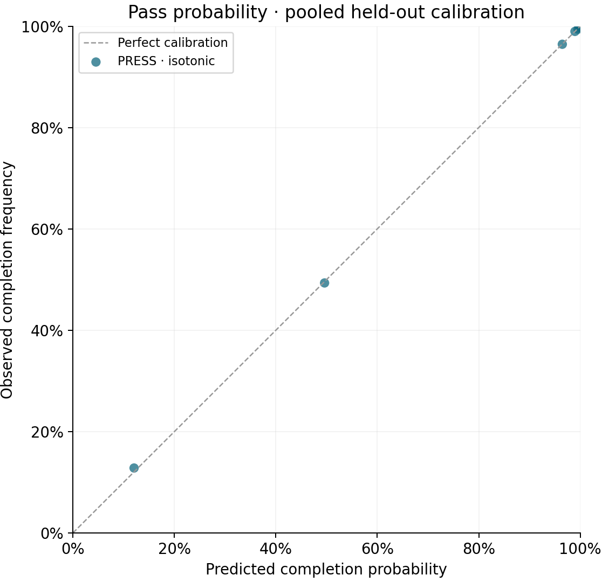

[Model and example](../vignettes/02_pass_probability/02_pass_probability.ipynb) · [All benchmarks](../benchmark.qmd)

This benchmark documents the cohort, estimation and predictive evaluation of the PRESS pass-probability model. The target is the completion of a pass by the attacking team, given the release state and a candidate destination. The [pass vignette](../vignettes/02_pass_probability/02_pass_probability.ipynb) defines the model: the control rate and the arrival-time dispersion are estimated by maximum likelihood on the reconstructed physical trajectories of observed passes, and the fitted mechanism is then used to compute a potential pitch control field (PPCF) for hypothetical destinations, whose raw scores are calibrated with an isotonic map. Here we report the evidence supporting this specification.

## 1. Evaluation cohort {#accepted-cohort-and-endpoint-checks}

The benchmark contains **6,706 passes: 5,742 completions and 964 failures (14.38%), across ten SkillCorner matches**, selected from **7,078 outfield pass candidates** by the matching criteria and the duration interval described below ([effective exclusion counts](../data/benchmarks/filters/effective_exclusions.csv)). Passers are outfield players; goalkeepers remain in the state and can receive or intercept passes.

Release and the immediate next individual-possession start must be matched in the same match/period, with positive chronology, no intervening annotated interruption and complete observed ball XY. For completed passes, the identified recipient must be the next carrier with a matched pass reception; for failures, the next endpoint is an opponent interception/recovery. The recovery location is a proxy for a failed pass's intended destination. Native-coordinate conversion, endpoint identity, tracking state and the five initial observations are checked. The passer's possession start and receiver's possession end need not both be matched.

Passes are retained when the duration from release to matched reception or recovery lies within the inclusive interval **[0.5, 10] s**. The lower bound ensures sufficient tracking observations to estimate the ball-flight initial conditions, whereas the upper bound limits the trajectory integration horizon. This interval is also consistent with the temporal selection adopted by Spearman [@spearman2017]. Passes with curvature above 5%, excluded in the original paper, are retained.

## 2. Model specification and features

### Ball-flight initial conditions {#ball-flight-initial-conditions}

The physical flight and player-reachability models, including their kinetic parameters and the selected player-speed setting $v_{\max}=5.5$ m/s, are described in the [model vignette](../vignettes/02_pass_probability/02_pass_probability.ipynb). Here we assess the reconstruction of the ball's initial conditions, which determines the trajectories used to fit the control parameters.

For each pass, the release position is observed and the first five ball positions, at 0, 0.1, 0.2, 0.3 and 0.4 s, are used to estimate the launch state. We compared two approaches: an initial velocity derived from the mean observed ball velocity and a position-based fit of the physical flight trajectory. The latter estimates launch speed and direction while keeping the observed release position fixed.

The two estimators were compared by their free-flight position-prediction error after 0.6 s and before the next ball control. Errors were averaged equally across matches. The choice was repeated separately for each physical fit, using only its training matches: six matches in each inner rotation, eight in each outer refit, and ten in the final production fit. One estimator was selected for the whole training partition.

Position-based fitting was selected in every outer fold and in the final fit, and in 19 of the 20 inner fits; the remaining inner fit selected the mean-velocity estimator. This reconstruction uses observations after release and is therefore an offline estimation procedure.

## 3. Model selection and validation {#parameter-fitting-and-calibration}

The control rate $\lambda_{\mathrm{control}}$ and arrival-time dispersion $s$ are estimated by **maximum likelihood**, maximizing the Bernoulli log-likelihood defined in the [pass vignette](../vignettes/02_pass_probability/02_pass_probability.ipynb).

The resulting parameters are then applied to hypothetical passes towards candidate destinations. Because these predictions use a destination-based control calculation, which differs from the observed-flight calculation used for fitting, the raw potential pitch control field (PPCF) scores are calibrated against pass outcomes.

### Optimization

The negative Bernoulli log-likelihood of the passes on the reconstructed trajectories is minimized without priors, and only $\lambda_{\mathrm{control}}$ and $s$ are estimated. The optimization is carried out in the coordinates $(\eta_\lambda,\eta_s)=(\log\lambda_{\mathrm{control}},\log s)$, so that both parameters remain positive without upper bounds.

Three complete and independent optimizations are run, starting from the following points:

| Start | $\lambda_{\mathrm{control}}$ | $s$ |
|---|---:|---:|
| 1 | 4.3 | 0.43 |
| 2 | 3.0 | 0.30 |
| 3 | 5.0 | 0.50 |

Each optimization uses BFGS, with gradients obtained by automatic differentiation. BFGS determines the step by line search, with a maximum of 500 iterations and a gradient tolerance of $10^{-4}$. A solution is admissible when its parameters and objective are finite and the maximum absolute gradient is below 0.01, and among the admissible solutions the one with the lowest final negative log-likelihood is retained. The procedure uses only the fitting data and is the same for the fits on six, eight and ten matches.

In the fit on the ten matches, the three starts converge to practically the same solution ($\lambda_{\mathrm{control}}=5.437830$ s$^{-1}$, $s=0.294560$ s) in 6, 6 and 11 iterations. The third start is retained, with an objective difference of the order of numerical precision.

### Evaluation and calibration

Evaluation is **match-wise**, with five outer folds of two held-out matches each. Within each fold the procedure is the following.

1. **Inner rotations.** Within the eight outer-training matches, four rotations train the physical model on six matches and generate predictions for the remaining two. The four held-out pairs are disjoint within the development set, so each development pass supplies one raw PPCF calibration score from a physical fit that omitted its match.
2. **Calibration map.** These out-of-fold predictions are used to fit an isotonic calibration map. A Platt calibrator is evaluated using the same calibration examples.
3. **Refit.** The physical parameters are re-estimated on all eight outer-training matches.
4. **Test.** The fitted calibration map is applied to the predictions for the two outer-test matches.

The initial-condition estimator is selected using training data only. The physical trajectory MLE, the initial-condition estimator choice and the isotonic/Platt fitting are separate operations, and the calibration step leaves $\lambda_{\mathrm{control}}$ and $s$ unchanged. The retained calibration method is a development decision based on the reported comparison.

## 4. Predictive performance {#predictive-performance}

| Model | Cross-entropy ↓ | Gain over null ↑ | ECE ↓ |
|---|---:|---:|---:|
| Physical model, uncalibrated PPCF | 0.150555 | 63.48% | 4.040% |
| Physical model + Platt calibration | **0.130010** | **68.46%** | 0.814% |
| **Physical model + isotonic calibration** | 0.131121 | 68.19% | **0.183%** |

Metrics are pooled over the 6,706 held-out pass predictions from the five outer folds. ECE uses ten equal-count probability bins; the null baseline is estimated within the corresponding training matches. Although Platt calibration gives a slightly lower cross-entropy, **isotonic calibration is selected for its substantially lower ECE**. This choice reflects the emphasis on calibrated completion probabilities.

## 5. Comparison with published results {#comparison-with-published-results}

| Study / model | Cross-entropy ↓ | Gain over null ↑ | ECE ↓ |
|---|---:|---:|---:|
| **PRESS, physical model + isotonic** | **0.131121** | **68.19%** | **0.183%** |
| Fernández et al. (2021), SoccerMap | 0.1900 | ≈62.40% | 0.470% |
| Stalpaert et al. (2022), CatBoost | 0.2087 | 63.85% | 0.310% |

The studies differ in dataset, completion prevalence, pass selection, available features and validation protocol; their metrics are reported as context. Fernández et al.'s gain is approximate, computed with the reported overall completion share. [@fernandez2021; @stalpaert2022]

## 6. Production model and parameter estimates

For deployment, the physical parameters are refitted on all ten matches. The final isotonic map is trained on out-of-fold predictions obtained by cross-fitting across the five outer folds.

### Parameter estimates {#parameter-estimates}

The final full-data physical fit yields **$\hat\lambda_{\mathrm{control}}=5.437830$ s$^{-1}$** and **$\hat s=0.294560$ s**. Estimates across the five outer training sets are:

| Parameter | Mean | SD | Range |
|---|---:|---:|---:|
| $\lambda_{\mathrm{control}}$ (s$^{-1}$) | 5.449711 | 0.294611 | 5.163824–5.929938 |
| $s$ (s) | 0.294478 | 0.006087 | 0.284215–0.300415 |

These ranges describe variation between training partitions. Spearman [@spearman2017] reported $\lambda=4.30$ s$^{-1}$ and a temporal dispersion of 0.45 s; differences should be interpreted in light of the distinct tracking data, trajectory reconstruction and movement assumptions.

## 7. Discussion and limitations {#curvature-and-limitations}

All accepted curvature levels are included in model fitting and evaluation. To assess where the simplified flight representation is less accurate, we stratified the held-out predictions by observed trajectory curvature without refitting either the physical model or its calibrator.

| Held-out subset | Passes | Failure share | Cross-entropy ↓ | Gain over subgroup null ↑ | ECE ↓ |
|---|---:|---:|---:|---:|---:|
| All passes | 6,706 | 14.38% | 0.131121 | 68.19% | 0.183% |
| Curvature <10% | 5,211 | 12.36% | 0.097953 | 73.84% | 0.227% |
| Curvature ≥10% | 1,495 | 21.40% | 0.246731 | 52.65% | 1.170% |

Curvature is measured as maximum perpendicular deviation from the release-to-endpoint line, relative to endpoint distance. Performance is substantially weaker for more curved passes. The absence of spin and Magnus effects is one plausible explanation; the subsets also differ in difficulty, geometry and failure prevalence.

Further limitations include the use of the observed recovery location as a proxy for the intended destination of failed passes, uncertainty in endpoint annotations, and simplified player motion. The initial-condition reconstruction requires at least 0.5 s of observed flight; shorter passes are outside the evaluated population.

## 8. Supplementary resources

The [pooled metrics](../data/benchmarks/pass_risk/metrics.csv), [calibration bins](../data/benchmarks/pass_risk/calibration_deciles.csv), [parameter estimates](../data/benchmarks/pass_risk/parameters.csv), [curvature diagnostic](../data/benchmarks/pass_risk/curvature_metrics.csv) and [production provenance](../docs/pass-risk-refit-provenance.json) support the reported results. The [research pipeline](../pipeline.qmd) provides trajectory reconstruction, parameter fitting, calibration and production refitting.
