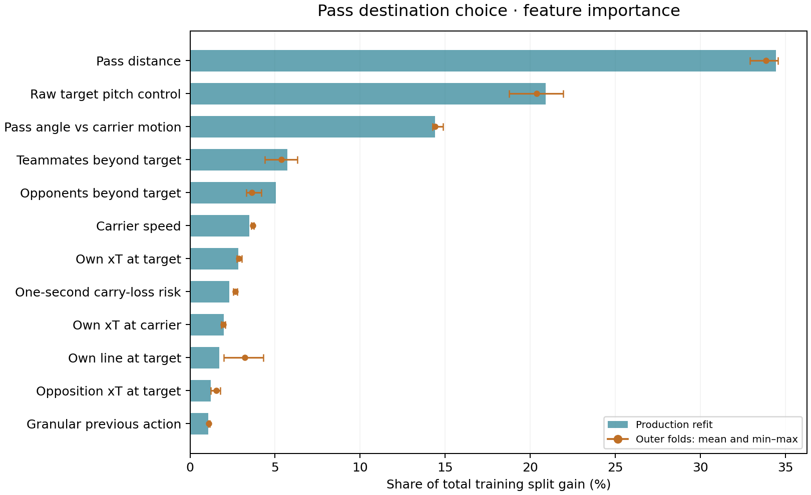

[Model and example](../vignettes/03_pass_selection/03_pass_selection.ipynb) · [All benchmarks](../benchmark.qmd)

The pass-selection model gives the probability of each candidate destination, conditional on a pass attempt. A shared XGBoost ensemble produces a utility for every destination, and a softmax turns the utilities into a categorical choice distribution. We also evaluate an exploratory cross-nested logit (CNL) that groups destinations probabilistically by potential receiver. The [model vignette](../vignettes/03_pass_selection/03_pass_selection.ipynb) introduces the choice model, its predictors and an executable example. The likelihood-based tree learning follows RUMBoost [@salvade2025rumboost].

## 1. Evaluation cohort {#evaluation-cohort}

The evaluation contains **6,810 decisions across ten SkillCorner matches**, of which **1,009 are unsuccessful passes**. Passers are outfield players. Unsuccessful passes are kept because destination choice is defined independently of completion. The observed endpoint is assigned to the nearest cell centre of the one-metre pitch grid, and all candidate cells enter the categorical normalization. The pooled uniform-choice reference cross-entropy is **8.873286**.

### Effective task-specific exclusions

The transition candidate base applies the [shared verified-pass-link criteria](../benchmark.qmd#verified-pass-links), a usable release state and its positive flight-duration limit below ten seconds. These criteria leave the **6,810 decisions**. Effective exclusion counts.

The cohort contains every pass of the final pass-probability cohort and also the passes shorter than 0.5 s. Destination choice uses the decision state and a hypothetical destination field, so the five initial ball observations used to reconstruct the observed flight, and the 0.5 s lower limit that they require, apply only to the pass-probability task.

## 2. Model specification and features {#features}

The model uses 19 numerical predictors and two one-hot encoded contextual variables (50 encoded columns). Definitions and groups are given in the [model vignette](../vignettes/03_pass_selection/03_pass_selection.ipynb). Pitch control enters in its raw form, and the observed receiver and outcome are excluded.

### Choice specifications and learning {#choice-specifications-and-learning}

For decision $i$, let $\mathcal G_i$ be the candidate destination cells, $y_i$ the observed destination and $z_{ij}$ the features of cell $j$. Both specifications use **one shared XGBoost ensemble**, $u_{ij}=f_\psi(z_{ij})$, to score all alternatives. They differ in the map from utilities to probabilities, and therefore in the derivatives used to fit the ensemble.

### Flat multinomial logit

The deployed specification applies a softmax:

$$
\pi_{ij}=\frac{\exp(u_{ij})}{\sum_{k\in\mathcal G_i}\exp(u_{ik})}.
$$

The ensemble minimizes the categorical negative log-likelihood

$$
\mathcal L(\psi)=-\sum_i\log \pi_{i,y_i}(\psi),
$$

with utility gradient $g_{ij}=\pi_{ij}-\mathbf 1\{j=y_i\}$. This is a **single categorical likelihood over destinations**: the probability of each cell depends on the utilities of all cells in the same decision.

### Exploratory cross-nested logit

The CNL keeps the same utility function and lets each destination belong fractionally to several **receiver nests**, one per eligible teammate other than the carrier. Membership $\alpha_{ijm}$ is proportional to teammate $m$'s **individual raw pitch control** at destination $j$, normalized over eligible teammates (a zero-control destination gets uniform membership). Memberships are fixed by the physical state.

A single dissimilarity parameter $\mu\in[0.1,1]$ ($\rho\in[1,10]$) is shared by all nests, because teammate identities and nest compositions change from decision to decision and teammate-specific scales would not be comparable. With $\rho=1/\mu$, define

$$
S_{im}=\sum_{j\in\mathcal G_i}(\alpha_{ijm}e^{u_{ij}})^\rho,
\qquad
\pi_{ij}=\sum_m
\underbrace{\frac{S_{im}^{1/\rho}}{\sum_l S_{il}^{1/\rho}}}_{\text{nest probability}}
\underbrace{\frac{(\alpha_{ijm}e^{u_{ij}})^\rho}{S_{im}}}_{\text{destination within nest}}.
$$

**At $\mu=1$ the CNL reduces to the flat softmax.** For $\mu<1$ it relaxes the independence-of-irrelevant-alternatives restriction of the flat model, allowing more structured substitution among destinations tied to the same receiver.

Both models minimize the **same observed-choice negative log-likelihood**. For the CNL, probabilities, gradients and curvature are computed from the CNL probability function. In both cases XGBoost receives one gradient and one scalar curvature per candidate.

### Iterative XGBoost estimation

The estimation follows RUMBoost [@salvade2025rumboost], adapted to XGBoost and a single shared utility ensemble (the RUMBoost reference implementation uses LightGBM). The same ensemble $f_\psi$ is evaluated on every candidate. Tree construction and regularization follow Chen and Guestrin [@chen2016xgboost]. Ensembles start from zero utilities, and the CNL also starts at $\mu=1$.

At boosting iteration $t$, the current utilities $u_{ij}^{(t)}$ define a full probability distribution over the destinations of each pass. The loss of the observed choice, $\ell_i=-\log \pi_{i,y_i}$, gives the direction in which utilities should move: alternatives with too much probability receive positive gradients, and the chosen destination receives a negative gradient in the flat model.

XGBoost then fits a regression tree $b_t$ to a second-order approximation of the loss, using the gradients $g_{ij}=\partial\ell_i/\partial u_{ij}$ and curvatures $h_{ij}$ of the candidate rows. For a leaf $A$ with $G_A=\sum_{(i,j)\in A}g_{ij}$ and $H_A=\sum_{(i,j)\in A}h_{ij}$, the leaf output is the standard

$$
w_A^*=-\frac{G_A}{H_A+\lambda}.
$$

The tree is added to the **utility function shared by all destinations**, with learning rate $\eta$:

$$
u_{ij}^{(t+1)}=u_{ij}^{(t)}+\eta\,b_t(z_{ij}).
$$

Because the update changes the probabilities of *all* destinations in a pass, gradients and curvatures are recomputed from the new categorical distributions before the next tree. This repeated re-evaluation of the choice likelihood is what links discrete-choice estimation to gradient boosting.

**Curvature convention.** The exact categorical Hessian has off-diagonal terms linking alternatives of the same pass, whereas XGBoost takes one scalar per row. This scalar is a curvature convention for constructing trees. For the flat softmax the implemented convention is

$$
h_{ij}^{\mathrm{flat}}=\max\!\left\{\varepsilon,\frac{J_i}{J_i-1}\pi_{ij}(1-\pi_{ij})\right\},
\qquad J_i=|\mathcal G_i|.
$$

The factor $J_i/(J_i-1)$ follows the [RUMBoost reference implementation](https://github.com/big-ucl/rumboost/blob/v1.0.2/rumboost/rumboost.py), [@rumboostrepository], and $\varepsilon=10^{-6}$ keeps the curvature away from zero. For the CNL, the gradient is the exact gradient of the CNL choice likelihood and the scalar curvature reproduces the published RUMBoost `f_obj_cross_nested` convention. The implementation passes the reference curvature to XGBoost unchanged. The two models therefore share the boosting machinery and optimize different probability maps. The scalar curvature is a tree-fitting approximation, and the dependence among candidate destinations is retained by the likelihood and its gradient. At $\mu=1$ the CNL probabilities and gradient reduce to the flat softmax, while the published CNL curvature convention differs numerically from the flat rule, so the boosting updates of the two models differ.

**Dissimilarity update.** The CNL learns $\mu$ together with the trees. After every 20 trees, the utilities are held fixed. The fitting-set CE is evaluated at the current $\rho$ and at $1,1.5,2,3,5,10$; one bounded SLSQP optimization over $\rho\in[1,10]$ starts from the best scanned value. Failed or uphill updates are rejected. This is a conditional scalar scan. Only 10% of the proposed move is applied, to avoid abrupt changes in the choice probabilities:

$$
\rho^{(t+1)}=\rho^{(t)}+0.1\bigl(\rho^*-\rho^{(t)}\bigr).
$$

Boosting then resumes with probabilities and derivatives recomputed at the new dissimilarity. Validation cross-entropy selects the joint checkpoint of tree ensemble and $\mu$. This alternating scheme extends the RUMBoost cross-nested approach [@salvade2024beyond] to fixed pitch-control memberships and the shared PRESS XGBoost utility. The 20-tree interval and 10% damping follow the [RUMBoost source implementation](https://github.com/big-ucl/rumboost/blob/main/rumboost/rumboost.py) [@rumboostrepository], as recorded in the reference provenance. They are implementation choices of the estimation procedure. The scalar scan, shared scale bounds and fixed pitch-control memberships are PRESS-specific adaptations.

## 3. Model selection and validation {#model-selection-and-validation}

### Hyperparameter screening

Before the held-out evaluation, **five hyperparameter configurations** were compared for each model family on **one development partition**: six matches for training and two for validation. The partition was the same for flat and CNL, and the remaining two matches were held out. The criterion was validation cross-entropy.

| Maximum depth | Minimum child weight | L2 | Flat | CNL |
|---:|---:|---:|---:|---:|
| 6 | 5 | 3 | 5.808242 | **5.774532** |
| 3 | 5 | 1 | 5.808396 | 5.800588 |
| 4 | 20 | 1 | **5.800526** | 5.775927 |
| 4 | 1 | 1 | 5.818136 | 5.794084 |
| 4 | 5 | 1 | 5.819215 | 5.794499 |

The lowest validation cross-entropy selects **depth 4, minimum child weight 20, L2 1** for the flat model and **depth 6, minimum child weight 5, L2 3** for the CNL. Both use learning rate 0.05, row and column subsampling 0.8, CPU histogram boosting, at most 2,000 trees and early-stopping patience 100. The screening used the fold-0 development partition once, and the selected settings are applied unchanged in every outer fold. Its validation matches are outer-test matches in other folds (see the [scope of the development benchmark](../benchmark.qmd#scope-of-the-development-benchmark)). These settings were **fixed before** the five-fold evaluation. There is one boosting trajectory per family/fold, initialized at zero utilities and $\mu=1$.

### Match-wise held-out evaluation

The selected configurations were evaluated on **five match-disjoint 6 + 2 + 2 partitions**:

- **Six training matches** fit the XGBoost utilities and the upstream feature components (physical pass-risk and ball-drive parameters, xT smoothing, categorical vocabulary).
- **Two fixed validation matches** select the tree checkpoint by early stopping on native choice CE, then fit a **single temperature-scaling parameter** with the selected trees and CNL dissimilarity held fixed. The same pair is used for both operations and stays fixed within that outer fold.
- **Two test matches** are used only for performance evaluation.

**Temperature scaling.** The calibrated distribution is $\pi_{ij}^{(T)}\propto \pi_{ij}^{1/T}$, as defined in the [model vignette](../vignettes/03_pass_selection/03_pass_selection.ipynb). The single scalar $T$ minimizes the cross-entropy of the observed choices on the two validation matches. $T>1$ flattens the distribution and $T<1$ concentrates it. The fitted values are close to one in every fold (table below), and the gain in cross-entropy is small. The deployed flat model retains the temperature.

The six-match tree fit is evaluated directly on the test matches. Temperature scaling is applied to the final destination distribution (after nest aggregation for CNL), with utilities, dissimilarity and the selected tree prefix held fixed. It is fitted after the hyperparameter screening and early stopping.

Each of the 6,810 decisions appears exactly once among the pooled test predictions. Upstream physical fitting and calibration are documented in the [pass-probability benchmark](02_pass_probability.qmd) and [ball-drive benchmark](01_ball_drive_risk.qmd). The full-data deployment refit is described at the end.

## 4. Predictive performance {#predictive-performance}

Pooled held-out results over the five partitions, with each family's screening-selected hyperparameters:

| Model | Calibration | Cross-entropy | McFadden $R^2$ |
|---|---|---:|---:|
| Flat | Raw | 5.828043 | 34.319% |
| Flat | Temperature | **5.827787** | **34.322%** |
| CNL | Raw | 5.816478 | 34.450% |
| CNL | Temperature | **5.810553** | **34.516%** |

Relative to the calibrated flat model, the calibrated CNL lowers cross-entropy by **0.017234** and raises McFadden $R^2$ by **0.194 percentage points**. Eight of ten match-level cross entropies favor the CNL. The advantage is small.

### Calibration

| Fold | Flat trees | CNL trees | CNL $\mu$ | Flat $T$ | CNL $T$ |
|---:|---:|---:|---:|---:|---:|
| 0 | 1,408 | 359 | 0.5770 | 1.0169 | 1.0607 |
| 1 | 1,444 | 399 | 0.5892 | 1.0170 | 1.0766 |
| 2 | 1,491 | 375 | 0.5514 | 0.9889 | 1.0342 |
| 3 | 1,527 | 359 | 0.6015 | 1.0069 | 1.0538 |
| 4 | 1,213 | 319 | 0.6253 | 1.0037 | 1.0524 |

All fits stopped before the tree ceiling. Given the modest CNL gain and its added structural and optimization complexity, **the flat model is retained for deployment** and the CNL is kept as an exploratory alternative.

### Feature importance {#feature-importance}

Split-gain importance is the total XGBoost split gain, normalized within each fitted ensemble, with one-hot levels grouped under their original feature. The figure and table refer to the deployed flat model and its five outer-fold fits. Bars show production shares; points and ranges show the fold mean and min–max, which describe variation across fits.

| Feature | Production gain share | Rank across outer folds |
|---|---:|---:|
| Pass distance | 34.44% | 1–1 |
| Raw target pitch control | 20.91% | 2–2 |
| Pass angle | 14.41% | 3–3 |
| Teammates beyond target | 5.72% | 4–4 |
| Opponents beyond target | 5.04% | 5–7 |
| Carrier speed | 3.49% | 5–6 |

Pass distance, raw target pitch control and pass angle account for 69.76% of production split gain and rank first, second and third in every outer fold. Destination player counts and carrier speed also contribute. These values describe how the trees use each input, and correlated inputs can share gain.

## 5. Comparison with published results {#comparison-with-published-results}

| Study / model | Cross-entropy ↓ | McFadden $R^2$ ↑ |
|---|---:|---:|
| **PRESS, flat + temperature scaling** | **5.827787** | **34.322%** |
| Fernández et al. (2021), SoccerMap | 5.7134 | ≈35.543% |

Fernández, Bornn and Cervone [@fernandez2021] report a pass-selection cross-entropy of **5.7134** (Table 4). The McFadden value shown here is **derived** from that figure with a uniform $104\times68$ choice grid. Their fully convolutional SoccerMap model was evaluated on a different dataset (**633 matches**), open-play cohort, split and candidate-grid construction. The comparison is reported as context.

## 6. Production model {#final-fitted-model}

After evaluation, the flat model was refitted on all ten matches with **1,444 trees** (the median validation-selected count across folds) and the screening-selected hyperparameters. The deployment model uses full-data physical feature fits and smoothed xT. Its temperature, **$T=1.0132954379$**, was estimated from reconstructed raw out-of-fold distributions. The CNL full-data refit (359 trees, $\mu=0.6263079567$, $T=1.0558986079$) is kept for research.

## 7. Discussion and limitations {#discussion-and-limitations}

The flat multinomial logit lowers the cross-entropy by 34.3% relative to the uniform-choice reference (5.827787 against 8.873286), using information available at the decision: pass geometry, pitch control, expected threat, pressure lines, ball-drive risk and match context. The temperature fitted in each fold is close to one, which suggests that the raw choice probabilities are already close to calibrated on the validation pair, and temperature scaling changes cross-entropy only marginally. The nested specification gave only a small gain over the flat model, so the flat model is deployed for its simplicity and the CNL is kept as an exploratory alternative. A plausible explanation is that the predictors (pass geometry, raw pitch control and the other contextual features) are already informative and that XGBoost uses them flexibly, which leaves little for the nest structure to add. The CNL evaluated here has one dissimilarity parameter shared by all nests and memberships fixed by individual pitch control, so the comparison covers this specific nesting structure.

Hyperparameter screening compares five configurations per model family on a single development partition. The computational cost of boosting over the full candidate grid limits the search to this size and to a single partition. Early stopping and temperature scaling share the same two validation matches within each fold. The evaluation covers ten matches from a single competition and season, and the comparison with Fernández et al. is reported as context because dataset, split and candidate grid differ. Generalization to other competitions, tracking providers and annotation conventions remains to be assessed.

Unsuccessful passes enter the training data with their recovery location as the observed destination. This location is a proxy for the intended destination and may be an interception point away from the intended destination. If so, the model assigns probability to regions that are contested more often than the intended destinations are, and the resulting distribution leans towards riskier destinations. This explanation remains to be tested; a direct check would refit the choice model on completed passes only and compare the downstream results.

## 8. Supplementary resources

For reproducibility, the screening table, [pooled metrics](../data/benchmarks/pass_selection/final_pooled_metrics.csv), [fold summaries](../data/benchmarks/pass_selection/final_fold_summary.csv), [per-match results](../data/benchmarks/pass_selection/final_metrics_by_match.csv) , [feature-importance summaries](../data/benchmarks/feature_importance/README.md) and installed artifact provenance are provided as supplementary resources.
