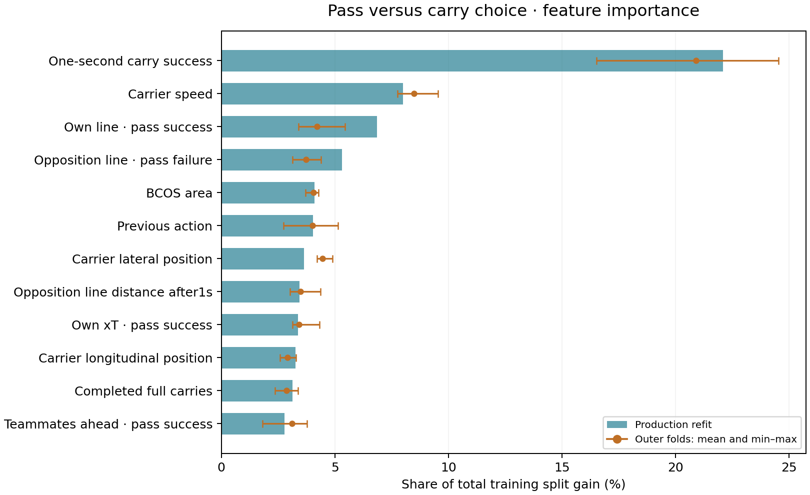

[Model and example](../vignettes/04_action_selection/04_action_selection.ipynb) · [All benchmarks](../benchmark.qmd)

The action-selection model estimates the probability that the ball carrier passes, $q(s)=P(\mathrm{pass}\mid s)$, at a given game state $s$; the probability of carrying is $1-q(s)$. The target is the observed **choice of action**. The classifier is a native XGBoost model with a binary logistic objective [@chen2016xgboost], with native probabilities retained for deployment; temperature scaling is evaluated as a diagnostic. The [model vignette](../vignettes/04_action_selection/04_action_selection.ipynb) introduces the 30 input features, the probabilistic summaries of hypothetical passing options and an executable example.

## Evaluation cohort

The final cohort comprises **16,918 decisions across ten SkillCorner matches**, of which **7,770 are passes and 9,148 are carries**. Carriers are outfield players, and individual possessions that end in a shot are excluded. Pass labels occur at the actual release. Carry labels are complete one-second successful carries and failed carries, including failures before one second. The segmentation of individual possessions into decision checkpoints is discussed in [Possessions and checkpoints](../vignettes/setup/possession_and_checkpoint_setup.ipynb).

### Effective task-specific selection

After the shared possession-level preparation, a decision is canonical when it is a pass at its release or a one-second carry attempt. Short-control tails, terminal-clearance snapshots and terminal-foul snapshots are noncanonical: they remain available for state evaluation and are excluded from the choice-training examples. The target is the observed pass or carry decision, so the terminal execution outcome is exempt from the OBE and pass-flight verification filters, and all failed canonical carries are retained. Unknown start and previous-action contexts are kept as predictor categories. These criteria leave the **16,918 decisions**. [Effective exclusion counts and snapshot counts](../docs/effective-filters-provenance.json).

## Features

The model uses **30 features**, 28 numerical and two categorical, in four groups. Their definitions are given in the [vignette](../vignettes/04_action_selection/04_action_selection.ipynb). The original start and previous-action categories, including `unknown`, are kept, and missing or unseen levels receive an explicit encoding. All features are built from information available at the decision frame, so future execution outcomes, receivers, remaining possession duration, player identity and role are excluded.

The upstream components are refitted for each evaluation split. Pass-completion physics, physical carry risk and arrival dispersion, and destination-choice utilities are fitted on the same **six training matches** as the action classifier, and the smoothed xT surface is estimated from those same six matches. BCOS uses the fold-specific carry-arrival dispersion (see the [kinematic conventions](../docs/kinematic-parameter-conventions.md)). Benchmark inputs are created only with components fitted on the training matches.

## Model and learning

For score $f_\psi(z_i)$ and $q_i=\operatorname{sigmoid}(f_\psi(z_i))$, the regularized Bernoulli loss is

$$
\mathcal L(\psi)=-\sum_i\big[y_i\log q_i+(1-y_i)\log(1-q_i)\big]+\Omega(\psi),
\qquad y_i=\mathbf1\{\mathrm{pass}\}.
$$

The native gradient and curvature with respect to the score are $q_i-y_i$ and $q_i(1-q_i)$, so training uses the standard XGBoost logistic objective.

A separate diagnostic fits a single temperature parameter $T>0$ on the existing validation matches with the selected trees held fixed [@guo2017calibration]:

$$q_T=\operatorname{sigmoid}\!\left(\frac{\operatorname{logit}(q)}{T}\right).$$

The diagnostic temperature minimizes validation negative log likelihood after the native grid and tree prefix have been selected. The selected configuration, trees and stopping rule remain unchanged. The same validation pair is reused for this diagnostic. The installed classifier returns native probabilities.

## Model selection and validation

### Hyperparameter search

In each of five match-disjoint **6 + 2 + 2 partitions**, all **144 configurations** of a grid were fitted, giving **720 fits**. The grid varied maximum depth (3, 4, 6, 8), minimum child weight (1, 5, 20), L2 leaf regularization (0.1, 1, 3, 10) and learning rate (0.03, 0.05, 0.10). Row and column sampling were fixed at 0.8, and training allowed at most 2,000 trees with early-stopping patience 100. Validation log loss selected the configuration and the tree prefix of each partition, and every candidate stopped before the tree ceiling.

| Fold | Depth | Minimum child weight | L2 | Learning rate | Selected trees |
|---|---:|---:|---:|---:|---:|
| 0 | 4 | 5 | 3 | 0.03 | 541 |
| 1 | 8 | 1 | 10 | 0.03 | 217 |
| 2 | 6 | 5 | 1 | 0.05 | 186 |
| 3 | 4 | 1 | 0.1 | 0.03 | 419 |
| 4 | 8 | 20 | 3 | 0.03 | 248 |

### Match-wise held-out evaluation

In each partition, **six matches** fit the XGBoost classifier and the upstream feature components. **Two fixed validation matches** select the configuration and, by early stopping, the number of trees. This pair remains fixed for every grid candidate in that outer fold. A later temperature diagnostic reuses it with the selected ensemble held fixed, and the six-match fit is evaluated directly on the test matches. The remaining **two test matches** were reserved exclusively for performance evaluation. One-hot vocabularies and encoded columns were fitted on training matches only. Each of the 16,918 decisions appears exactly once among the pooled test predictions.

## Predictive performance

The pooled null model predicts the pass proportion of the corresponding six training matches. Cross entropy (CE) uses natural logarithms, and expected calibration error (ECE) uses ten equal-count rank bins on the pooled predictions.

| Model | CE | Null CE | Gain over null | Brier | AUC | Quantile ECE |
|---|---:|---:|---:|---:|---:|---:|
| **PRESS, native XGBoost** | **0.568592** | **0.690053** | **17.602%** | **0.193975** | **0.77083** | **1.026%** |
| Temperature scaling (diagnostic) | 0.568411 | 0.690053 | 17.628% | 0.193872 | 0.77092 | 0.817% |

Fold-level gains over the null range from **16.20% to 19.02%**. The uncalibrated classifier's mean absolute bin deviation is approximately **1.03 percentage points**, with a maximum near **2.41 points** (@fig-action-selection-calibration).

{#fig-action-selection-calibration}

The fold temperatures were **1.0875, 1.0256, 1.0279, 1.0153 and 1.0537**. Relative to the raw output, temperature scaling reduces pooled ECE from **1.026% to 0.817%**, with a CE change of **−0.000180** and a null-gain change of **+0.026 percentage points**. The gain is small. These are diagnostic scores. Because the improvement from temperature scaling is marginal, the installed model keeps the native probabilities (`calibration.method = "none"`), consistent with the main calibration plot.

## Feature importance

Split-gain importance for the deployed model and the five outer-fold models is shown below, with one-hot levels aggregated to their original feature. Gain shares describe contributions to training splits.

| Feature | Production gain share | Outer-fold rank range |
|---|---:|---:|
| One-second carry success | 22.09% | 1–1 |
| Carrier speed | 8.00% | 2–2 |
| Team line on pass success | 6.85% | 3–9 |
| Opponent line on pass failure | 5.32% | 5–14 |
| BCOS | 4.10% | 4–7 |
| Previous action | 4.04% | 3–18 |

Carry-success probability and carrier speed rank first and second in every outer fold.

Two context extensions were also assessed without changing the feature set: the verified origin of the team-possession chain and the previous completed-pass count. With fixed hyperparameters, paired fits and three seeds, the origin feature changed null gain by an average of **+0.105 percentage points**, the count by **+0.039** and both together by **+0.053**, with the joint change ranging from **−0.056 to +0.148 points**. These small, variable changes did not motivate adding the features.

## Comparison with published results

| Binary action-choice model | CE | Null CE | Gain over null |
|---|---:|---:|---:|
| Stalpaert, major action categories | 0.5762 | 0.6602 | 12.72% |
| **PRESS, native XGBoost** | **0.568592** | **0.690053** | **17.60%** |
| Stalpaert, specific action types included | 0.4807 | 0.6602 | 27.19% |

Stalpaert et al. [@stalpaert2022] study the same binary pass–carry choice. PRESS has a lower CE and a higher gain than Stalpaert's model with major action categories, and the model that includes specific action types reaches a higher gain; with our labels we could not obtain a comparable benefit. The studies differ in dataset, class balance (null CE 0.6602 versus 0.690053), available features and validation protocol, and the values are reported as context.

Fernández et al. [@fernandez2021] motivate the decomposition of action choice and execution. Their shoot/pass/carry classifier has a different label space and serves as context for this binary task.

## Final fitted model

The production model is a native XGBoost refit on all ten matches and **16,918** decisions, with **277 trees** and native probabilities. Its configuration (depth 6, minimum child weight 1, L2 10, learning rate 0.03) has the lowest mean validation CE across the five fold-specific search grids. For this configuration, the best tree prefixes in the five folds are 242, 329, 369, 253 and 277, and their median, 277, fixes the tree count. These deployment values are selected from validation records.

Production features use the full-data pass-risk, carry-risk, destination-choice and xT models, and BCOS uses the full-data carry dispersion. All held-out scores above refer to the five outer-fold models.

For reproducibility, the [selected configurations](../data/benchmarks/action_selection/selected_configurations.csv), [encoded feature schemas](../data/benchmarks/action_selection/feature_schemas.json), [pooled metrics](../data/benchmarks/action_selection/metrics.csv), [fold scores](../data/benchmarks/action_selection/metrics_by_fold.csv), [per-match scores](../data/benchmarks/action_selection/metrics_by_match.csv), [temperature values](../data/benchmarks/action_selection/temperature_diagnostic.csv), [literature values and locators](../data/benchmarks/action_selection/literature_comparison.csv), [importance tables](../data/benchmarks/feature_importance/README.md), [context-extension results](../data/benchmarks/action_selection/context_probe_summary.csv) with [seed-level comparisons](../data/benchmarks/action_selection/context_probe_by_seed.csv), [refit provenance](../docs/action-selection-refit-provenance.json) and [benchmark provenance](../docs/action-selection-benchmark-provenance.json) are provided as supplementary resources.