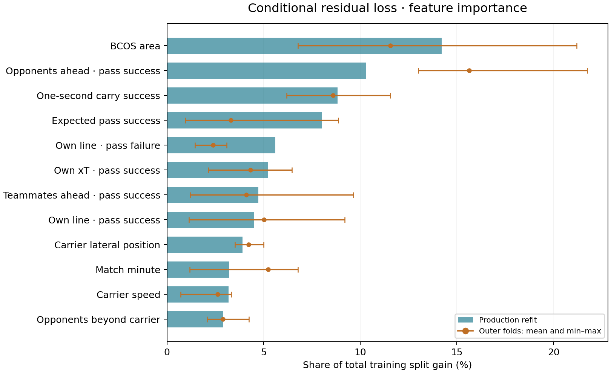

[Model and example](../vignettes/05_residual_risk/05_residual_risk.ipynb) · [All benchmarks](../benchmark.qmd)

The residual-risk model estimates, for a successful one-second carry, the probability that the individual possession ends in a terminal loss. A failed terminal pass, a direct possession loss or a clearance is labeled loss, and a completed terminal pass or a foul suffered is labeled no loss; the verification conventions are given in the [evaluation cohort](#evaluation-cohort). The [model vignette](../vignettes/05_residual_risk/05_residual_risk.ipynb) introduces the conditional terminal-outcome task, its likelihood, the relationship to the action-selection features, feature importance and an executable example. This benchmark documents the outcome conventions, the cohort, the training protocol, the predictive evaluation and the final fit. The classifier is a native XGBoost model with a binary logistic objective [@chen2016xgboost].

## 1. Evaluation cohort {#evaluation-cohort}

Successful canonical one-second carries are identified as described in [Possession segmentation and context](../vignettes/setup/possession_and_checkpoint_setup.ipynb). Each eligible state is a completed one-second carry within an outfield player's individual possession, and shorter interrupted tails are excluded. The target is the terminal outcome of that individual possession.

Terminal outcomes are verified with the same conventions as Pass Selection and Ball Drive: terminal passes require verified continuous direct reception, and direct possession losses follow the OBE verification of the physical carry model. Terminal passes are retained irrespective of duration, curvature or unknown context. A failed terminal pass or a direct `possession_loss` is labeled loss ($Y=1$), and a completed terminal pass is labeled no loss ($Y=0$). Individual possessions ending in a clearance ($Y=1$) or a foul suffered ($Y=0$) are also included, while those ending in a shot are excluded. Clearances are treated as terminal losses under the assumption that they are induced by defensive pressure.

The cohort contains 7,820 successful one-second carry states, of which 1,423 end in a terminal individual loss (18.20%), across ten matches and 3,975 individual possessions. A possession can contribute more than one state.

| Terminal individual outcome | States | Individual possessions | Loss label |
|---|---:|---:|---:|
| Completed pass | 6,258 | 3,214 | 0 |
| Failed pass | 742 | 397 | 1 |
| Direct possession loss | 654 | 286 | 1 |
| Clearance | 27 | 14 | 1 |
| Foul suffered | 139 | 64 | 0 |

### Effective task-specific exclusions

The conditional target starts from 8,672 successful canonical one-second carry states in the broad action cohort. Terminal-outcome verification removes 14 states from 10 loss-ending parents without a valid associated OBE, and 838 states from 452 parents whose terminal pass is absent from the verified continuous direct-receipt cohort. All eligible states belonging to an affected parent are removed together. The two groups are disjoint, leaving 7,820 states from 3,975 individual possessions.

This target requires an observed successful full second, so the conditional training set consists of successful canonical carries. Completed passes, failed passes, clearances and fouls retain the labels shown above, with terminal passes of any flight duration or curvature.

## 2. Model specification and features {#features}

The model uses 31 features: the action-selection feature family with two changes. The number of completed carries is replaced by the elapsed time since individual control began, and the carry probability $P(\mathrm{carry})=1-q(s)$, with $q(s)=P(A=\mathrm{pass}\mid s)$ the pass-choice probability of action selection, is added. The shared feature definitions are in the [action-selection vignette](../vignettes/04_action_selection/04_action_selection.ipynb).
For this task $P(\mathrm{carry})$ is cross-fitted, so that every state is scored by an action-selection model that did not see its match. The procedure is described in the next section.

## 3. Model selection and validation {#model-selection-and-validation}

The evaluation uses five match-disjoint outer folds with 6 fitting + 2 validation + 2 test matches. The two validation matches remain fixed throughout each outer fold. They support upstream calibration and downstream grid/early-stopping selection, and the test matches are used only for evaluation. The six-match fit is evaluated directly on the test matches.

The XGBoost grid covers maximum depth (3, 4, 6, 8), minimum child weight (1, 5, 20), L2 regularization (0.1, 1, 3, 10) and learning rate (0.03, 0.05, 0.10), giving 720 fits for the reported 31-feature model, which includes $P(\mathrm{carry})$. Row and column subsampling are 0.8, training allows at most 2,000 trees, and early-stopping patience is 100. Validation cross-entropy selects the configuration and the tree prefix before testing. Training uses the standard logistic objective on the original class frequencies, and the retained model returns native probabilities.

### Cross-fitted P(carry)

Action selection learns the observed pass/carry labels on many of the same carry checkpoints that enter residual-risk training. It is also a flexible tree model. Using its in-sample predictions could therefore make $P(\mathrm{carry})$ artificially confident on those observations; omitting their match reduces this source of bias in the learned feature. The physical ball-drive model shares carry checkpoints but has a more constrained parameterization. The pass-probability and pass-selection models are fitted on pass observations, with less direct overlap with residual-risk carry checkpoints. This makes $P(\mathrm{carry})$ the priority for an additional cross-fitting step.

Cross-fitting is applied at the action-classifier layer: the action classifier that scores a fitting state omitted its match. Within each outer fold, training states are scored by three action-selection refits, each fitted on four of the six training matches with the XGBoost parameters of the fold and omitting the other two, and validation and test states are scored by the action-selection model of the same outer fold. These inner refits change the action-classifier weights only. Their physical, pass-choice, xT and BCOS inputs remain frozen from the outer six-match feature stack. The upstream features keep their outer-fold fits at this stage, so training-row predictions from those components can still be in-sample with respect to their own fits.

## 4. Predictive performance {#predictive-performance}

| Model | CE | Null CE | Gain over null | Brier | AUC | ECE |
|---|---:|---:|---:|---:|---:|---:|
| XGBoost, native | 0.419506 | 0.475594 | 11.793% | 0.131390 | 0.73950 | 1.053% |

### Calibration

All reported scores refer to the retained model, using its native probabilities. In each fold the null model predicts the terminal-loss frequency of the fitting matches. Metrics pool the held-out states, and ECE uses ten equal-count pooled bins weighted by their counts.

{#fig-residual-risk-calibration}

### Feature importance {#feature-importance}

Feature importance is the total XGBoost split gain, normalized within each ensemble, with one-hot levels grouped under their original feature. The figure shows the production model and the five outer-fold models, and fold ranges describe variation in the fitted rankings.

{#fig-residual-risk-importance}

| Feature | Production gain share | Rank across outer folds |
|---|---:|---:|
| BCOS | 14.21% | 1–4 |
| Opponents ahead, success-weighted | 10.30% | 1–2 |
| One-second carry success | 8.83% | 2–4 |
| Expected pass success | 8.01% | 4–25 |
| Team line on pass failure | 5.60% | 10–19 |
| Team xT on pass success | 5.24% | 5–12 |

Accessible space and the spatial configuration of the passing options lead the ranking. BCOS accounts for 14.21% of the total split gain and ranks between first and fourth across folds, and the opponents ahead of likely completed passes contribute 10.30% and rank first or second. The rank of expected pass success varies widely across folds (4–25), so its production share carries a less stable ordering. Importance measures describe predictive use.

## 5. Comparison with published results {#related-published-work}

A targeted literature search on 29 October 2026 found no published cross-entropy, null-gain or ECE result for this conditional terminal individual-possession target.

| Work | Published target and result | Difference from this task |
|---|---|---|
| [Gu et al., *Player Pressure Map*](https://arxiv.org/abs/2401.16235) | Team outcome at 4 s; accuracy 55.8% (tracking), 75.2% (2D PPM), 78.7% (3D PPM) | Team-level horizon, sequence inputs and accuracy as the metric |
| [Dick and Brefeld, *Action rate models for predicting actions in soccer*](https://doi.org/10.1007/s10182-022-00435-x) | Next-action rate and turnover before a pass; 75% top-1 turnover hit rate at 1 s before the observed loss | Different labels and metric |
| [Le Coz et al., *A semi-Markov framework for modeling football possessions and temporal expected threat*](https://doi.org/10.1038/s41598-026-52938-1) | Team goal probability within a time budget, from event sequences | Different outcome, state and horizon |

## 6. Production model {#final-fitted-model}

The production model is a native 118-tree refit on all 7,820 eligible states. Depth 4, minimum child weight 5, L2 1 and learning rate 0.03 minimize the mean validation cross-entropy across the five grids. The best tree prefixes of this configuration in the five folds are 118, 133, 251, 87 and 92, and their median, 118, fixes the refit length.

The production residual-risk model is trained on out-of-fold values of $P(\mathrm{carry})$, obtained as follows. The action-selection model is trained on eight of the ten matches, with the hyperparameters and number of trees selected for production action selection, and predicts $P(\mathrm{carry})$ for the two remaining matches. Repeating this five times, so that every pair of matches is predicted once, gives a $P(\mathrm{carry})$ value for every training state of residual risk. The residual-risk model is then fitted on all ten matches using these values. At inference on new data, $P(\mathrm{carry})$ comes from the production action-selection model, trained on all ten matches.

## 7. Discussion and limitations {#limitations}

Body orientation and posture are unavailable in this 2D tracking dataset, and the features use velocity direction in place of a measured body orientation (see Gu et al. above). The features summarize current carrier motion, tactical configuration and passing opportunities; full recent trajectories and explicit pairwise histories, as used by recurrent and graph-based action-rate models (Dick and Brefeld, above), are outside the feature set.

## 8. Supplementary resources

For reproducibility, the [metrics](../data/benchmarks/residual_risk/primary_pooled_metrics.csv), selected configurations, [fold scores](../data/benchmarks/residual_risk/primary_metrics_by_fold.csv), [per-match scores](../data/benchmarks/residual_risk/primary_metrics_by_match.csv), [remaining-time diagnostic](../data/benchmarks/residual_risk/primary_remaining_time_sensitivity.csv), literature locators, [feature-importance analysis](../data/benchmarks/feature_importance/README.md) and refit provenance are provided as supplementary resources.
