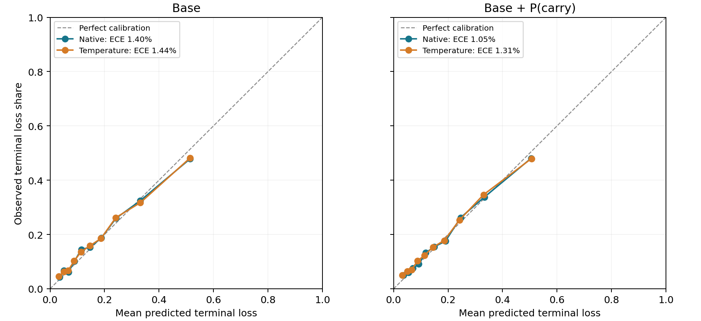
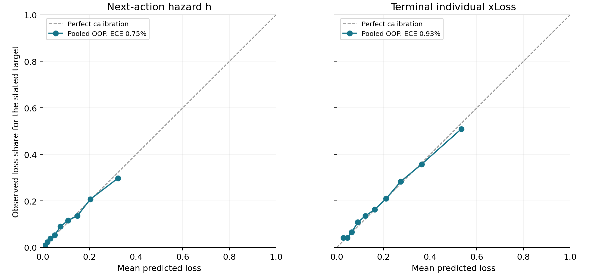

[Model and example](../vignettes/05a_residual_risk/05a_residual_risk.ipynb) · [All benchmarks](../benchmark.qmd)

The [residual-risk vignette](../vignettes/05a_residual_risk/05a_residual_risk.ipynb)
defines the conditional target, all 31 inputs, executable composition and the
installed deployment model. A [separate composed-risk benchmark](../vignettes/05b_composed_risk_benchmark/05b_composed_risk_benchmark.ipynb)
reports h and xLoss evaluation and their pooled calibration. Residual risk is optional for current pressure:
it completes local action risk to a terminal individual-possession forecast.

## Verified cohort and unchanged training protocol

RR77 uses **7,820 successful canonical one-second carry states**, 1,423 terminal
individual losses (18.20%), ten matches and 3,975 individual possessions.
Failed terminal passes, direct possession losses and clearances are positive;
completed passes and fouls suffered are negative. Clearances are an operational
individual-loss convention, not necessarily team turnovers. Whole individual
parents require outfield control, no shot ending and matched endpoints. A
terminal pass must have verified continuous direct reception; direct-loss
parents follow the physical carry model's OBE verification. No 0.5–10s duration,
curvature or unknown-context filter is added. The previous broad RR74 cohort
contained 8,672 states: verification removes 838 pass-ending states and 14
successful carry states from 10 of the 20 excluded non-OBE loss parents.

The base has 30 conceptual inputs; the augmented model adds native P(carry).
Outer folds use **6 fit + 2 validation + 2 test matches**, with the matching
per-fold physics/pass/choice/xT/BCOS stack. Three fixed four-fit/two-omitted AS
refits supply six-fit training scores; matching outer AS models score validation
and test. This cross-fits action weights, not the entire upstream feature stack.
Validation supports both upstream calibration and downstream selection; these
are development OOF results, not independent external validation.

The native XGBoost grid is depth {3,4,6,8}, child weight {1,5,20},
L2 {0.1,1,3,10}, eta {0.03,0.05,0.1}: 144 settings × two variants × five folds
= 1,440 fits [@chen2016xgboost]. Row/column subsampling is 0.8, hist bins 256,
tree cap 2,000, early stopping 100. Depth/support vary capacity, L2 shrinks leaf
weights and eta controls update size. Validation CE selects configuration and
tree prefix before test prediction. No resampling, class weighting or custom
derivatives. A positive validation-only temperature is fitted to the frozen
selected ensemble [@guo2017calibration]; no test score selects its value.

## Conditional residual: pooled OOF scores

| Variant | CE | Null CE | Gain | Brier | AUC | Quantile ECE |
|---|---:|---:|---:|---:|---:|---:|
| Base, native | 0.420779 | 0.475594 | 11.526% | 0.131963 | 0.73765 | 1.396% |
| Base, temperature | 0.421193 | 0.475594 | 11.438% | 0.131999 | 0.73707 | 1.441% |
| Base + P(carry), native | 0.419506 | 0.475594 | 11.793% | 0.131390 | 0.73950 | 1.053% |
| Base + P(carry), temperature | 0.419773 | 0.475594 | 11.737% | 0.131395 | 0.73963 | 1.315% |

Native augmented output remains primary: temperature worsens CE and ECE.
P(carry) adds only 0.268 percentage points of gain over the native base model.
The null uses each fold's six-fit empirical terminal-loss frequency; gain is
1−CE/nullCE in natural logarithms. Metrics concatenate held-out states, and
ECE is recomputed on ten pooled equal-count bins, weighted by bin counts.

{#fig-residual-risk-calibration}

[Metrics](../data/benchmarks/residual_risk/pooled_metrics.csv),
[selected configurations](../data/benchmarks/residual_risk/selected_configurations.csv),
[folds](../data/benchmarks/residual_risk/metrics_by_fold.csv),
[matches](../data/benchmarks/residual_risk/metrics_by_match.csv).

Remaining time is retrospective, not an input. The
[verified-cohort horizon diagnostic](../data/benchmarks/residual_risk/remaining_time_sensitivity.csv)
reports four groups and an equal-possession weighting sensitivity; differing
situation mixes and small tails do not establish a monotonic horizon effect.

## Composed xLoss: same-fold evaluation

With pass policy p, destination-weighted pass failure f, carry failure d and
conditional continuation c, h=pf+(1−p)d and xLoss=h+(1−p)(1−d)c.
A completed pass ends this individual's control; no teammate continuation is
added. **Own derivation** from the law of total probability.

The common verified cohort has **15,085 canonical checkpoints**: 7,820 successful
carries, 456 failed carries and 6,809 pass releases. The local target has 1,465
failed actions; the terminal target has 2,888 individual losses. All components
use matching outer-fold weights, never the full-data deployment refits. No
additional scaling is fitted to either composition.

| Forecast and target | CE | Six-fit null CE | Gain | AUC | Quantile ECE |
|---|---:|---:|---:|---:|---:|
| h: next selected action fails | 0.272014 | 0.319133 | 14.765% | 0.78168 | 0.749% |
| xLoss: terminal individual loss | **0.421925** | 0.489296 | **13.769%** | 0.75645 | **0.930%** |

These are **different targets with different nulls**; their gains are not a
like-for-like model ranking. Base c yields composite CE 0.421439 and ECE 1.072%;
this ablation does not trigger outer-test selection of a new residual model.
Omitting c and evaluating h against the terminal target yields CE 0.500633 and
ECE 9.443%, illustrating the missing horizon rather than h's own task accuracy.

{#fig-composed-risk-calibration}

[Pooled metrics and cohort sensitivities](../data/benchmarks/composed_risk/pooled_metrics.csv),
[calibration bins](../data/benchmarks/composed_risk/calibration_quantile10.csv),
[folds](../data/benchmarks/composed_risk/metrics_by_fold.csv),
[matches](../data/benchmarks/composed_risk/metrics_by_match.csv).
Additional short-tail hazard snapshots are descriptive and are outside this
canonical-action CE evaluation. Whole-parent quality verification is
retrospective; residual composition also extrapolates the hypothetical
successful-carry continuation to pass and failed-carry states. No proprietary
company metric is used as a numerical benchmark.

## Published work: related tasks, not a common numerical benchmark

A targeted search of academic primary sources on29October2026 found no published
CE/null-gain/ECE result for this exact conditional terminal individual target.
This is a search finding, not a claim of priority or an exhaustive systematic review.

| Work | Published target and result | Why not a direct RR benchmark |
|---|---|---|
|Gu et al., Player Pressure Map|Team outcome at4s; accuracy55.8% tracking,75.2%2D PPM,78.7%3D PPM; Table1|Team horizon and sequence inputs; accuracy, not conditional-terminal CE [@gu2024pressure].|
|Dick & Brefeld, Action Rate Models|Next-action rate/turnover before a pass; turnover top1 hit rate75% at1s before observed loss, §4.1|Different label space and metric; no matched conditional residual CE/null/ECE [@dick2023actionrate].|
|Le Coz et al., semi-Markov temporal xT|Team goal probability within a time budget, from event sequences|Different outcome, state and horizon [@lecoz2026semimarkov].|

[Primary sources and locators](../data/benchmarks/residual_risk/related_literature.csv).
Fernández and Stalpaert's one-second carry-execution benchmarks belong to the
carry section; they do not evaluate this residual terminal continuation.

## Deployment refit78

The package loads **`skillcorner_outfield_residual_risk_verified_v2`**, the native
118-tree full-data refit on 7,820 eligible states. Depth 4, child weight 5,
L2 1 and eta 0.03 minimize mean validation CE over the five RR77 grids. For this
setting the best prefixes are 118/133/251/87/92: median 118 fixes refit length,
without using test scores. The verified AS73 full-data summaries are reused;
five eight-fit/two-omitted AS fits supply training P(carry), while inference
uses the installed all-ten-match AS73 model. Full-matrix export replay and 200
public state-record fixtures passed. Upstream model hashes are unchanged and
the previous export is archived. Production fitting is not an OOF benchmark.
[Refit provenance](../docs/residual-risk-refit-provenance.json).

## Limitations and possible extensions

Body orientation and posture inferred from video in the PPM work are unavailable
in this2D tracking dataset; velocity direction remains a proxy, not a measured
body orientation [@gu2024pressure]. Tracking-only extensions could retain more
recent trajectory history and explicit pairwise interactions instead of reducing
the configuration to current-frame aggregates. The recurrent graph and movement
distribution in Action Rate Models illustrate a different model family
[@dick2023actionrate]. Our pressure, passing-option, line, xT, BCOS and elapsed-time
inputs already cover related current-state summaries. These papers do not
establish that another simple covariate would improve this residual target.
Past-only changes in pressure or passing availability are a possible future
feature-engineering experiment, not a feature tested here or a demonstrated
improvement. No new feature is added to the frozen refit78 specification.
