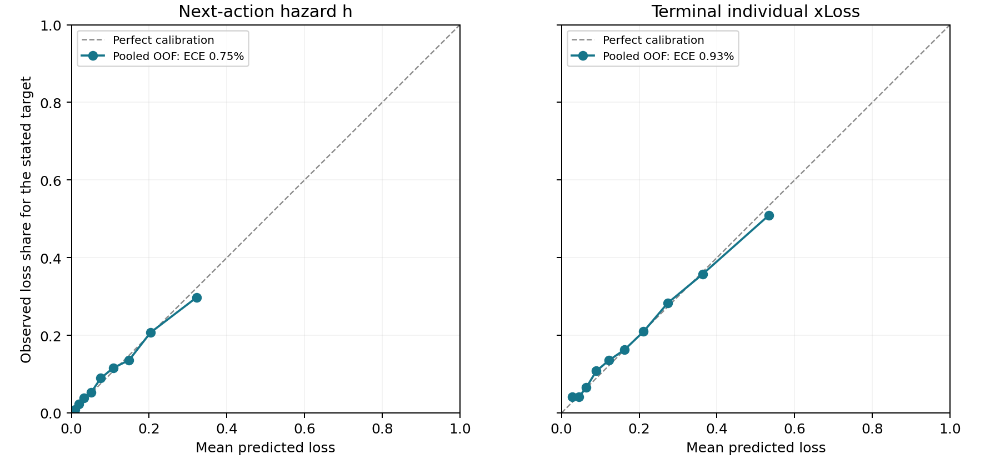

[Model and example](../vignettes/06_composed_risk/06_composed_risk.ipynb) · [All benchmarks](../benchmark.qmd)

This benchmark evaluates the composed hazard $h$ and the individual xLoss, which have distinct targets: failure of the current canonical action, and loss by the end of the carrier's individual possession. An individual possession is the control of the ball by a single player, as segmented in [Possessions and checkpoints](../vignettes/setup/possession_and_checkpoint_setup.ipynb), and it ends with a terminal action: a pass, a possession loss, a clearance, a shot or a foul suffered. A completed pass ends the individual possession without a loss, while a failed pass or a direct possession loss ends it with a loss. The [model vignette](../vignettes/06_composed_risk/06_composed_risk.ipynb) introduces the composition, the difficulty bands and an executable example, and this benchmark documents the cohort, the evaluation procedure, the predictive performance and the band validation.

Let $q(s)$ be the probability of selecting a pass, $\pi_j$ the probability of the destination $j$ and $p_j$ the probability that a pass to $j$ is completed, so that $f(s)=\sum_j \pi_j(1-p_j)$ is the pass-failure probability averaged over the destination distribution. Let $d(s)=1-D(s)$ be the loss probability of the canonical one-second carry, the complement of the carry-success probability $D(s)$, and $r(s)$ the probability of terminal individual loss conditional on a successful carry, evaluated from the current state. The composed predictions are

$$
h(s)=q(s)f(s)+\big(1-q(s)\big)d(s),
$$

$$
\operatorname{xLoss}(s)=h(s)+\big(1-q(s)\big)\big(1-d(s)\big)r(s).
$$

Each prediction is evaluated against its own observed target: $h$ against the failure of the current action (a failed pass, or a loss during the one-second carry), and xLoss against the terminal individual loss.

## 1. Evaluation cohort {#evaluation-cohort}

### Effective task-specific exclusions

The cohort starts from the canonical action-selection checkpoints. A checkpoint is kept when the terminal outcome of its parent possession is verified: a loss-ending parent needs a valid associated OBE, defined in the [ball-drive benchmark](01_ball_drive_risk.qmd), and a terminal pass must belong to the verified continuous direct-receipt cohort. Verification concerns the parent's terminal outcome, so earlier checkpoints of an affected possession are removed as well. Terminal passes are retained irrespective of observed flight duration. These criteria leave **15,085 verified-outcome checkpoints**. Effective exclusion counts.

The overall predictive metrics of $h$ and xLoss use all 15,085 checkpoints, including the earlier valid carry checkpoints of possessions ending in a foul suffered or a clearance. Every checkpoint has an observed current-action outcome for $h$ and a verified terminal individual outcome for xLoss. The pooled metrics and calibration curves retain all checkpoints, irrespective of terminal coverage or possession duration.

### Cohort for difficulty bands and possession profiles

The [$h$-band validation and the subsequent possession-profile analysis](../vignettes/06_composed_risk/06_composed_risk.ipynb) additionally require coverage of the terminal canonical action. A pass supplies its release checkpoint, and a failed carry supplies the start of the final failed action, at most one second before loss. [Micropossessions](../vignettes/setup/possession_and_checkpoint_setup.ipynb) remain eligible with their single pass or failed-carry checkpoint. Possessions ending in a foul suffered or a clearance have no terminal canonical action, so their earlier successful-carry states are excluded from this cohort, which has **14,919 states from 7,265 possessions**. The rule applies to the band analysis only, with predictions and component models unchanged.

## 2. Evaluation procedure {#evaluation-procedure}

Both predictions are obtained by composing the component outputs directly. At each eligible outer-test checkpoint, their terms are composed from the matching six-fitting/two-validation model stack, using native action-selection and residual-risk outputs, calibrated pass-completion probabilities, and the temperature-calibrated flat pass-selection distribution. The same fold-specific upstream quantities enter every term, and the full-ten-match deployment fits are left out of the evaluation. Metrics are then recomputed on the pooled composed predictions against each target.

## 3. Predictive performance {#predictive-performance}

Both targets are evaluated on **15,085 held-out canonical checkpoints**: **1,465 current-action failures** for $h$ and **2,888 terminal individual losses** for xLoss. This verified-outcome set is smaller than the action-selection training set, which requires an identifiable choice. The one-second segmentation is described in [Possessions and checkpoints](../vignettes/setup/possession_and_checkpoint_setup.ipynb). Scores are pooled across the five outer test folds for each target.

| Target | Checkpoints | Events | Cross-entropy | Null cross-entropy | Gain over null | AUC | ECE |
|---|---:|---:|---:|---:|---:|---:|---:|
| Current-action failure ($h$) | 15,085 | 1,465 | 0.272014 | 0.319133 | 14.765% | 0.78168 | 0.749% |
| Terminal individual loss (xLoss) | 15,085 | 2,888 | 0.421925 | 0.489296 | 13.769% | 0.75645 | 0.930% |

Relative to the null models, cross-entropy is lower by **14.8%** for $h$ and **13.8%** for xLoss, with AUC of **0.782** and **0.756** and ECE below **1%** for both targets. The null cross-entropy uses the event frequencies of the corresponding fitting data, and ECE is computed on ten equal-count bins of the pooled predictions.

The underlying results are available as [pooled metrics](../data/benchmarks/composed_risk/pooled_metrics.csv), [calibration bins](../data/benchmarks/composed_risk/calibration_quantile10.csv), [fold-level metrics](../data/benchmarks/composed_risk/metrics_by_fold.csv) and [match-level metrics](../data/benchmarks/composed_risk/metrics_by_match.csv).

## 4. Band validation intervals {#band-validation-intervals}

The $h$ bands of the [model vignette](../vignettes/06_composed_risk/06_composed_risk.ipynb) are validated on the 14,919 held-out states of the band cohort. Predictions and band thresholds are fixed, and the intervals quantify between-match variability in this sample.

Intervals are 95% percentile intervals from **2,000 whole-match bootstrap replicates**, with seed **20261030** [@efron1993bootstrap]. Each replicate draws ten matches with replacement and includes all their eligible actions, preserving multiplicity. For every band, mean predicted $h$ and the observed frequency of current-action failure are recomputed, and the bounds are the 2.5th and 97.5th percentiles. The paired gap is the difference between the two means within each replicate, and its interval is taken from the same replicates. Action selection remains native, and pass completion retains its fold-specific isotonic calibration.

Whole matches are resampled because actions within a match are dependent. Band counts are unequal, so the denominators vary across draws: High contains 665–1,053 actions across replicates (median 841), and no band is empty in any replicate. With ten matches the 95% level is indicative, and the intervals quantify the sampling variability of the evaluation, conditional on the fitted models.

| Band | Actions | Mean predicted $h$ (95% interval) | Observed failures (95% interval) |
|---|---:|---:|---:|
| None | 8,659 | 2.93% [2.77%, 3.09%] | 3.40% [2.83%, 3.98%] |
| Low | 2,936 | 11.87% [11.82%, 11.93%] | 12.26% [10.72%, 14.09%] |
| Medium | 2,483 | 21.40% [21.27%, 21.50%] | 21.67% [19.20%, 24.41%] |
| High | 841 | 36.53% [35.88%, 37.21%] | 32.46% [29.19%, 36.27%] |

In High, the paired predicted-minus-observed gap is 4.07 percentage points with a 95% interval of −0.07 to 7.82 points. The [bootstrap aggregates](../data/examples/pressure_report/h_band_bootstrap_terminal_coverage_20261105.csv) and provenance record the procedure.
