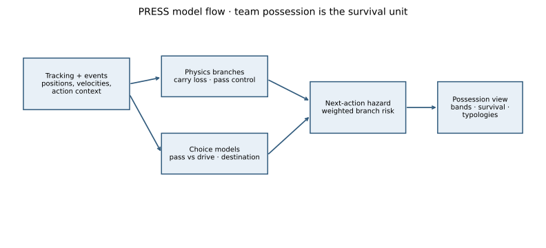

PRESS is a work-in-progress, physics-informed framework for quantifying the risk of losing team possession in a given game situation. It combines physics-based models of passing and ball carrying with learned decision-making policies to assess possession vulnerability at different horizons, from the ball carrier's next action to the eventual outcome of the possession.

## Browse the project {#browse-the-project}

::: {.page-directory}

::: {.directory-section}
### Models {#models}

1. [Ball-drive risk](vignettes/01_ball_drive_risk/01_ball_drive_risk.ipynb)
2. [Pass probability](vignettes/02_pass_probability/02_pass_probability.ipynb)
3. [Pass selection](vignettes/03_pass_selection/03_pass_selection.ipynb)
4. [Action selection](vignettes/04_action_selection/04_action_selection.ipynb)
5. [Residual risk](vignettes/05_residual_risk/05_residual_risk.ipynb)
:::

::: {.directory-section}
### Risk profiles and reports {#risk-and-reports}

- [Hazard and risk bands](vignettes/06_composed_hazard_and_bands/06_composed_risk_and_bands.ipynb)
- [Possession difficulty](vignettes/07_case_studies/07_case_studies.ipynb)
- [Pressure patterns and cases](vignettes/07_case_studies/07_case_studies.ipynb)
- [Team and player report](vignettes/07_case_studies/07_case_studies.ipynb)
:::

::: {.directory-section}
### Guides {#guides}

1. [Dataset and preprocessing](data.qmd)
2. [Possession segmentation and context](vignettes/setup/possession_and_checkpoint_setup.ipynb)
3. [Installation and use](vignettes/00_match_workflow/00_match_workflow.ipynb)
:::

::: {.directory-section}
### Benchmarks {#benchmarks}

- [Ball-drive risk](benchmarks/01_ball_drive_risk.qmd)
- [Pass probability](benchmarks/02_pass_probability.qmd)
- [Pass selection](benchmarks/03_pass_selection.qmd)
- [Action selection](benchmarks/04_action_selection.qmd)
- [Residual risk](benchmarks/05_residual_risk.qmd)
- [Composed risk (h and xLoss)](benchmarks/06_composed_risk.qmd)
:::

::: {.directory-section}
### Spatial features: accessibility and value {#spatial-features}

- [Ball Carrier Open Space](vignettes/spatial_features/bcos/10_bcos.ipynb)
- [Expected Threat](vignettes/spatial_features/expected_threat/11_expected_threat.ipynb)
:::

::: {.directory-section}
### Reference {#reference}

- [Python API](api.qmd)
- [Solver reference](solvers.qmd)
- [Research pipeline](pipeline.qmd)
- [Project plan](roadmap.qmd)
:::

:::

## Motivation

PRESS started as a personal portfolio project aimed at gaining hands-on experience with football event and tracking data, while developing a deeper understanding of the main components of Expected Possession Value (EPV) and expected possession loss (xLoss) frameworks. A central objective is to translate these concepts into reusable software components, with transparent implementations, reproducible examples, and opportunities to experiment with alternative modelling choices.

The foundations of the framework explored in PRESS are drawn from literature on pitch control and possession valuation [@spearman2017; @fernandez2021]. In particular, the decomposition of possession outcomes into action-dependent components (action selection, pass destination choice, and the success or loss probability of each action) follows the general philosophy of EPV models. PRESS approaches these ideas from a possession-retention perspective, focusing on the risk of losing the ball, with particular emphasis on the vulnerability induced by defensive pressure.

The implementation also provides an opportunity to explore alternative formulations for individual EPV components. One example is a [physics-based model of ball-drive success](vignettes/01_ball_drive_risk/01_ball_drive_risk.ipynb). Building on the arrival formulation of Bekkers [@bekkers2025] and the pitch-control framework of Spearman [@spearman2017], we explore whether the relative movement and interception capabilities of defenders and the ball carrier can be used to construct a probabilistic model of retaining control during a ball drive. This provides a physically motivated alternative to black-box models that estimate ball-drive success from spatial and contextual features.

For action and pass destination selection, we experiment with tree-based discrete-choice models, which are well suited to decision tasks. Such tasks do not follow physical laws, but they can draw on features derived from the physics-based components, among them the open space available to the ball carrier, measured by the [Ball Carrier Open Space](vignettes/spatial_features/bcos/10_bcos.ipynb) (BCOS), a concept introduced in [@bandara2025bcos] that PRESS formalizes within a competing-risks framework. BCOS is the area of the pitch that the carrier can reach before any opponent. It summarizes the space potentially controlled by the carrier over a horizon longer than the one-second horizon of the ball-drive risk model, which makes it a predictive feature for choosing the next action or predicting the terminal loss of a possession, together with tactical and contextual features. More generally, PRESS follows a hybrid modelling strategy by design: physical models characterize the feasibility and risk of potential actions, while learned tree-based models describe how players select among the available alternatives.

These components are combined to estimate possession vulnerability at two complementary horizons. The first concerns the ball carrier's next canonical action and provides a local estimate of possession-loss risk, which can be used to characterize instantaneous pressure. The second, xLoss, estimates the probability of losing possession over its remaining course. Together, these perspectives allow us to investigate both the immediate difficulty of retaining the ball and the broader implications for possession outcomes.

The following sections introduce the individual components, their underlying assumptions, and the modelling choices explored in PRESS.

## Framework overview

### Possession as a Markov decision process

PRESS adopts a Markov Decision Process (MDP) perspective on football possession, following the modular approach to Expected Possession Value (EPV) developed by Fernández, Bornn and Cervone [@fernandez2021]. In this formulation, possession is viewed as a sequence of decisions and actions undertaken by successive ball carriers, where each action has an uncertain outcome.

This perspective provides a convenient way to separate three fundamental aspects of possession: **which actions are available, how likely they are to succeed, and how players choose among them**. This decomposition is central to the EPV framework, where individual components can be estimated separately and subsequently combined to evaluate possession outcomes.

PRESS builds on this modular decomposition to estimate possession-loss risk under an average decision-making policy learned from observed play. Let $s_t$ denote the game state at time $t$, represented by the positions and movements of players and the ball, together with relevant tactical and contextual information.

We consider two canonical on-ball actions: **ball drive** and **pass**. A ball drive corresponds to retaining control of the ball for a conventional interval of one second, whereas a pass represents an attempt to transfer the ball to a selected destination while maintaining team possession. Unlike a ball drive, a pass has a variable duration, determined by the execution and completion of the attempt.

The framework combines four probabilistic components:

1. **Ball-drive risk:** the probability of losing possession during the one-second ball drive,

   $$
   d_t=P(\mathrm{loss}\mid s_t,A_t=\mathrm{drive}).
   $$

2. **Pass probability:** the probability of retaining team possession through a pass towards destination $j$,

   $$
   p_{j,t}=P(\mathrm{success}\mid s_t,A_t=\mathrm{pass},J_t=j).
   $$

3. **Pass selection:** the probability of choosing destination $j$, conditional on attempting a pass,

   $$
   \pi_{j,t}=P(J_t=j\mid s_t,A_t=\mathrm{pass}),
   \qquad \sum_j\pi_{j,t}=1.
   $$

4. **Action selection:** the probability of choosing a pass over a ball drive,

   $$
   q_t=P(A_t=\mathrm{pass}\mid s_t).
   $$

The pass-success and ball-drive components characterize the physical difficulty of executing potential actions, while action and destination selection describe how players are expected to choose among the available alternatives. The latter are learned from observed behaviour using tree-based models, incorporating features derived from the physics-based components alongside tactical and contextual information.

### Possession-loss hazard

The canonical actions introduced above provide a conventional way to segment possession into a discrete sequence of on-ball action opportunities (see [Possession segmentation and context](vignettes/setup/possession_and_checkpoint_setup.ipynb)). Each opportunity is associated with a predefined checkpoint at which the current game state is evaluated. A successful ball drive allows the same player to continue controlling the ball, whereas a successful pass transfers control to a teammate. Since the event of interest is the loss of **team possession**, a completed pass does not terminate the process: the sequence continues across successive ball carriers until possession is lost.

This conventional segmentation allows possession to be represented as a discrete survival process. Let $T$ denote the number of canonical on-ball actions until team possession is lost, and let $s_n$ represent the game state at the $n$-th checkpoint. The probability of losing possession during the next action, conditional on having retained it up to the current opportunity, defines the discrete hazard:

$$
\boxed{
h_n=P(T=n+1\mid T>n,s_n).
}
$$
PRESS estimates this probability by combining the action-specific risks through the average decision-making policy learned from observed play. The hazard is therefore marginalized over the possible actions and pass destinations, and not conditioned on the action actually chosen by the player:

$$
\boxed{
h(s_t)=(1-q_t)d_t+
q_t\sum_j\pi_{j,t}(1-p_{j,t}).
}
$$
The first term represents the contribution of ball-drive risk, while the second averages pass-failure risk across potential destinations. Together, they quantify the vulnerability of team possession in the current state under typical decision-making behaviour.

Importantly, the possession segmentation provides the **discrete interpretation** of the hazard, while $h(s_t)$ can be computed at any reliable state $s_t$, including frames between canonical checkpoints, to monitor possession difficulty throughout play. At every frame it remains a per-action quantity: the probability of losing possession during the next canonical action, equal to $h_n$ when $s_t$ is the state at checkpoint $n$. Intermediate evaluations add observations of risk without adding canonical actions.

### Pressure intensity and possession difficulty

Defensive pressure is a collective phenomenon. Defenders can restrict the space available to the ball carrier, close passing lanes, reduce the accessibility of teammates, and force the attacking team towards less favourable decisions. Its impact therefore depends not only on the proximity of individual defenders but also on the opportunities available to the player in possession.

By combining the physical feasibility of available actions with the average decision-making policy, the possession-loss hazard captures these interacting effects and provides an operational measure of **possession difficulty under defensive pressure**.

The conventional segmentation of possession into canonical actions also allows the process to be interpreted within the framework of **survival analysis**. In particular, the hazard can be related to the expected lifetime and half-life of possession under the hypothetical assumption that the current level of difficulty remains constant across subsequent action opportunities. The half-life represents the number of actions required for the probability of retaining possession to decrease to $50\%$ if the same hazard were maintained. It therefore provides an intuitive interpretation of possession difficulty: the higher the hazard, the shorter the reference half-life. This is not a prediction of actual possession duration, since difficulty evolves throughout play.

Inspired by SkillCorner's approach to classifying defensive pressure [@skillcorner2026], PRESS uses this survival-based interpretation to define **possession-difficulty bands**, whose construction and thresholds are described in the [hazard and risk bands vignette](vignettes/06_composed_hazard_and_bands/06_composed_risk_and_bands.ipynb).

The main application is to characterize the difficulty encountered by individual players and investigate their ability to retain possession under pressure. Evaluating the hazard throughout individual possessions produces risk profiles, while comparing observed outcomes across difficulty levels provides a basis for assessing player performance relative to the situations faced.

### From possession-loss hazard to xLoss

The possession-loss hazard measures the probability of losing team possession during the next on-ball action. A complementary perspective concerns the eventual outcome of the **current ball carrier's individual possession**, which may extend beyond the next action.

The distinction arises primarily from ball carrying. A successful one-second drive preserves individual possession but does not determine its eventual outcome: the player may continue carrying the ball, attempt a pass, or lose control later. Conversely, a successful pass terminates the current player's individual possession without causing a loss of team possession.

To account for this longer horizon, we add a **residual-risk component**. Conceptually, the eventual outcome of an individual possession is an absorption probability, which would follow from iterating the evaluation over successive states, each with its own action choice and loss risk, until the possession ends. Since the space of possible continuations is unbounded, the residual-risk component approximates this quantity directly from observed outcomes, as the probability that the current individual possession eventually terminates in a loss, conditional on successfully completing the initial ball drive:

$$
r_t=
P(\mathrm{eventual\ individual\ possession\ loss}
\mid s_t,\mathrm{successful\ drive}).
$$

The probability of eventual loss through the ball-drive branch therefore combines the risk of losing the ball during the initial drive with the residual risk following its successful completion:

$$
d_t+(1-d_t)r_t.
$$

Marginalizing over the same average decision-making policy used for the hazard gives the expected loss probability:

$$
\boxed{
\mathrm{xLoss}(s_t)=
(1-q_t)\left[d_t+(1-d_t)r_t\right]
+
q_t\sum_j\pi_{j,t}(1-p_{j,t}).
}
$$

Equivalently,

$$
\boxed{
\mathrm{xLoss}(s_t)=h(s_t)+(1-q_t)(1-d_t)r_t.
}
$$

The additional term represents the probability contribution from an initially successful drive followed by an eventual loss of individual possession. Unlike the hazard, which concerns the next action, xLoss incorporates this longer-horizon risk through the residual-risk component, without explicitly modelling the subsequent sequence of decisions.

Together, $h(s_t)$ and $\mathrm{xLoss}(s_t)$ provide complementary measures of possession vulnerability. The former characterizes immediate possession difficulty and supports survival-based difficulty bands and pressure profiles; the latter estimates the probability that the current player's individual possession will eventually end in a loss. Both are evaluated under the average decision-making policy, independently of the action actually performed.

## Model flow

The diagram illustrates how the individual model components are combined to estimate possession-loss hazard and xLoss. Each component is described in a dedicated vignette, covering its mathematical formulation, input variables, implementation, and application to real match situations using tracking and event data.

Each modelling task is also accompanied by a dedicated benchmark page, where its predictive performance is evaluated and compared, whenever possible, with results reported in the academic literature for similar tasks. The main references for these comparisons are Fernández, Bornn and Cervone [@fernandez2019] and Stalpaert et al. [@stalpaert2022]. These benchmarks provide a basis for assessing the performance of individual components in relation to existing approaches, while accounting for differences in datasets, modelling assumptions, and evaluation protocols.

Finally, the documentation includes **case studies and player-level reports** illustrating how PRESS can be applied to real match situations. These analyses explore possession vulnerability, defensive pressure, and individual performance, demonstrating how the framework's estimates can be used to characterize the difficulty players face and their ability to retain possession under pressure.

## Data and reproducibility

PRESS uses the publicly available [SkillCorner A-League sample](https://github.com/SkillCorner/opendata) as its primary source of tracking and event data. The analyses and examples are based on real match situations, allowing the framework to evaluate possession vulnerability in the context of observed player movements, defensive configurations, and on-ball decisions.

Raw tracking files are not redistributed with the package. Analyses and notebooks can be reproduced using the pinned Python environment and the corresponding match data. Instructions for obtaining and preparing the dataset are provided in the [dataset and preprocessing guide](data.qmd), alongside installation and reproducibility information in the [repository README](README.md).

## Start using the package

To get started with PRESS, follow the [user guide](usage.qmd) or explore the [installation and use example](vignettes/00_match_workflow/00_match_workflow.ipynb), which illustrates the analysis of real match situations using tracking and event data.

The workflow begins by loading and validating a match, then selecting team possessions, individual frames, and canonical action checkpoints. The relevant model components can subsequently be evaluated to estimate possession vulnerability and generate risk profiles.

For implementation details, consult the [Python API reference](api.qmd) and [scientific solver reference](solvers.qmd). The [project roadmap](roadmap.qmd) outlines ongoing development and planned extensions.
